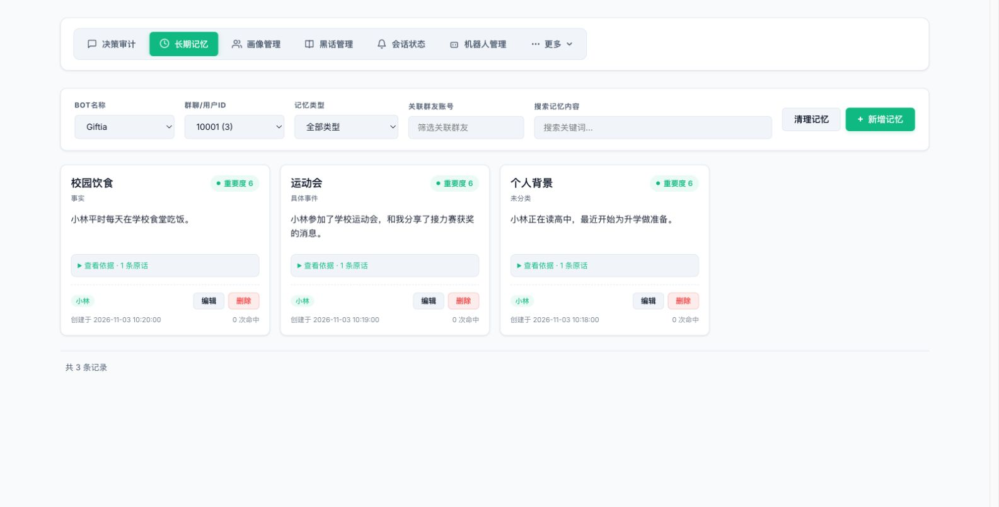
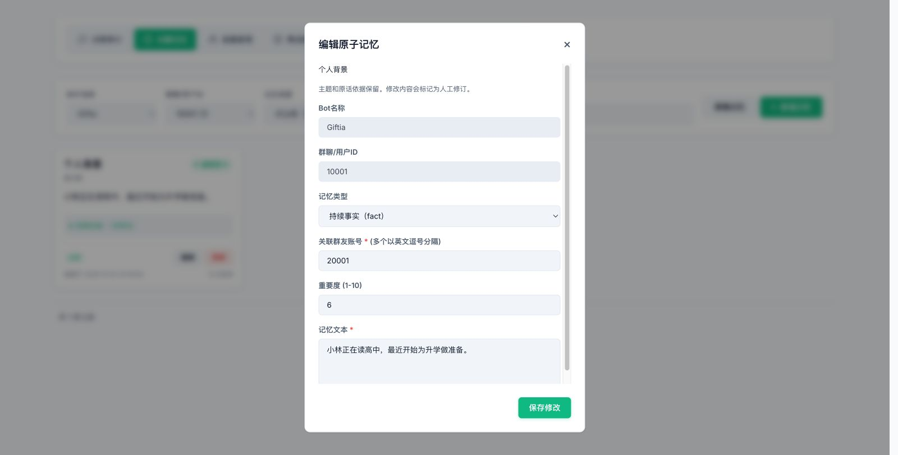
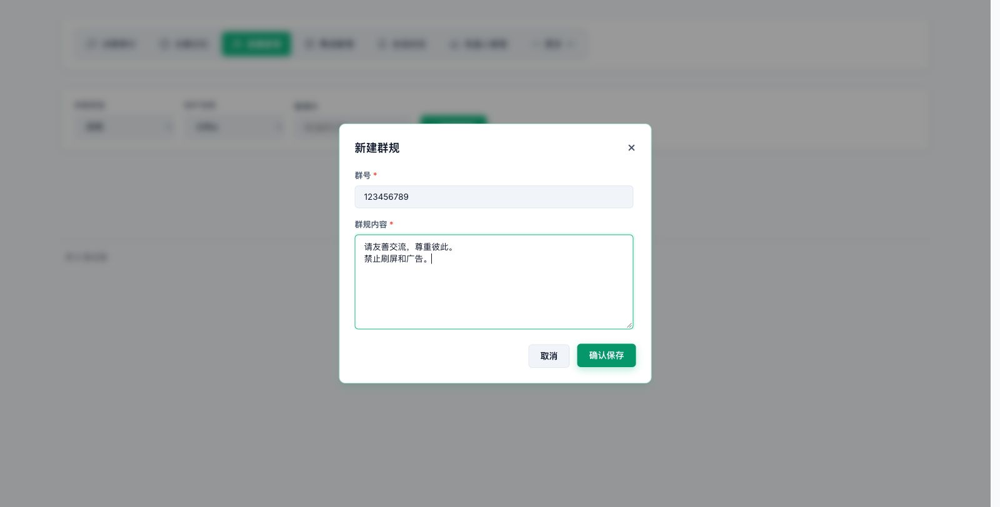
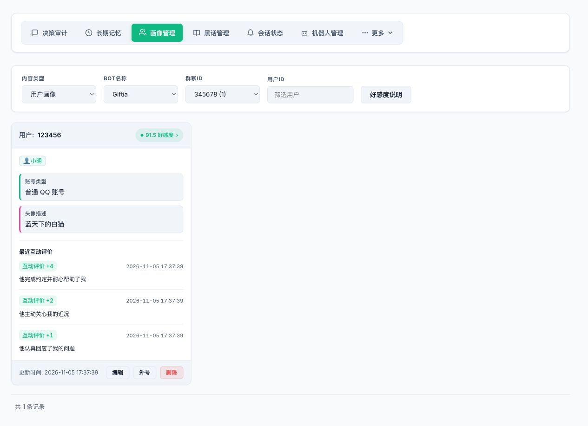
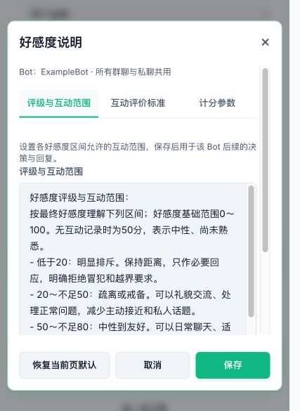
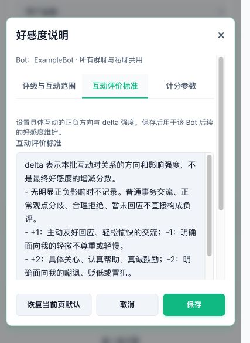
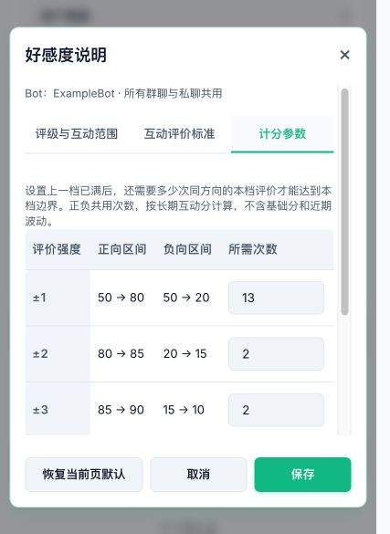
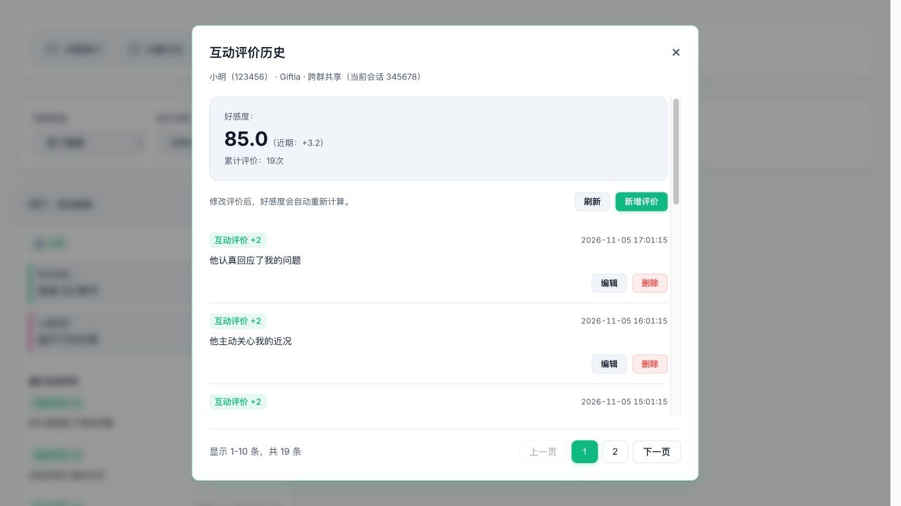
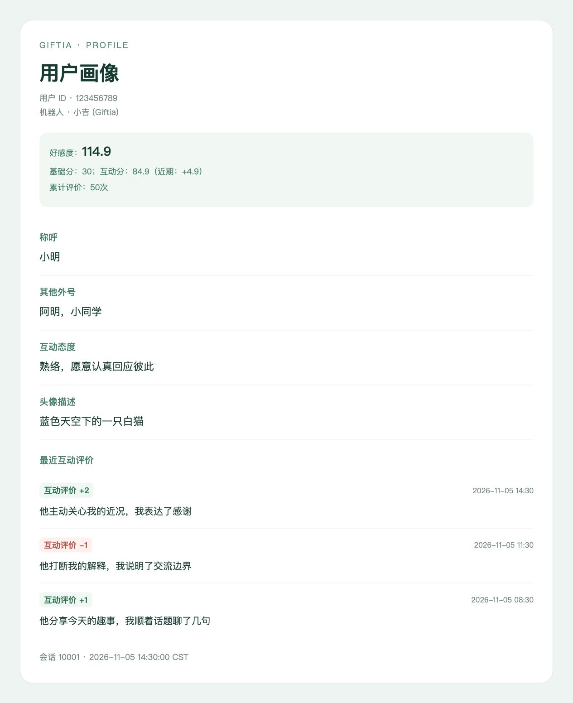

# Atomic memory management

## Long-term memory operations

Open Giftia WebUI from the AstrBot plugin page and select **长期记忆 (Long-term memory)**. Each record stores a fact (`fact`, including continuing information and retrospective experiences) or a current or recent concrete event (`event`). Records without a type appear as unclassified and can be labelled manually in the editor.

1. Select a bot and conversation, then filter by type, associated account or text. Types include all, facts (`fact`), concrete events (`event`) and unclassified records. Associated accounts use complete IDs for exact matching; clicking a member label also applies that filter.
2. Narratives describe participants, actions, interaction direction and how a fact was learned. Cards show the topic as a bold heading, with importance at the top right and type, manual-entry or edit labels below the heading. Known event timestamps follow the narrative; creation time and hit counts appear at the bottom. Extracted facts use creation time, with necessary factual dates retained in the narrative. Expand the evidence section to inspect direct speech and media captions.
3. Add a memory by selecting fact or event and entering associated accounts, topic, importance and text. New records are marked as manual entries without fabricated source evidence, and the view selects their conversation and type.
4. Edit type, text, importance and associated accounts. Unclassified records can be labelled fact or event; clearing the type returns them to unclassified. Topics and original evidence remain unchanged; edits are marked as manual revisions. Refresh before editing a record changed by another request.
5. Memory cleanup inherits the selected conversation, type, member and text filters. Preview candidates before choosing records to delete.





Management pages and administrator commands handle deletion; the bot queries memories through `search_memory`. Directly supported personality, interest and agreement information is stored as individual facts.

## Group rules

In **画像管理 (Profile management)**, switch **内容类型 (Content type)** to **群规 (Group rules)**, select a bot, and click **新建群规 (New group rules)**. Enter the group ID and rule content, then save. Bots without existing rules can create their first entry directly. Saving selects the target group; use **编辑 (Edit)** on a card to change its rules. Each bot and group ID has one rule entry, so saving replaces existing content for that pair.



## Profile management

### Shared data and preferred names

Avatar descriptions and affinity are shared by bot and user. Different bots remain independent. Preferred names are stored by bot, conversation and user: use the current conversation's name first, then the latest valid name set for that user within the same bot. Reading a name or editing other profile fields does not change that ordering. Aliases and their counts remain local. In Profile management → Edit, the Conversation name field edits only the current conversation; leaving it empty uses the latest name. A fallback appears as a placeholder and is not saved as a local name when editing other fields.

Member cards display final affinity at the top. The affinity dialog shows final affinity with the net effect of recent ratings in parentheses, followed by the total evaluation count. Cards show the latest three interaction ratings in newest-first order, with the time, rating strength and reason, plus a source label for entries from another group or private conversation. Fewer entries are shown when history is short; the entire recent-rating section is hidden when there are no records. Filter long-term memories by account to inspect a member's facts.



An incoming user message accepted for storage creates a missing base profile and registers its conversation, independently of replies, passive maintenance or preferred-name updates. Initialization neither creates interaction ratings nor overwrites existing profile fields. The bot's own messages, system notices, operation logs, recalled messages and blocked messages do not initialize profiles.

### Affinity guidance

In **画像管理 → 用户画像 (Profile management → User profiles)**, select a bot and click **好感度说明 (Affinity guidance)**. Three tabs share settings across that bot's group and private conversations:

- **评级与互动范围 (Ratings and interaction ranges)** describes score bands and allowed interactions for subsequent decisions and replies, up to 12,000 characters.
- **互动评价标准 (Behavior rating guidance)** defines the direction and strength of delta for subsequent background maintenance, up to 12,000 characters. Defaults distinguish each magnitude from one to five. Normal disagreement, reasonable refusal and an unanswered message do not directly justify a negative rating. Affectionate words do not automatically warrant strong ratings, and several ordinary messages do not mechanically accumulate into a higher tier. Evidence requirements, account ownership and output format remain fixed.
- **计分参数 (Scoring parameters)** edits only the number of same-direction ratings needed to move from the previous tier's completed boundary to this tier's boundary. Each count is an integer from 1 to 1,000,000, shared by positive and negative ratings. These are long-term interaction-score intervals, excluding the manual base and recent corrections. Higher-tier ratings can fill lower ranges without unlocking tiers in sequence.

| Magnitude | Positive interval | Negative interval | Default count |
| --- | --- | --- | --- |
| ±1 | 50 → 80 | 50 → 20 | 13 |
| ±2 | 80 → 85 | 20 → 15 | 2 |
| ±3 | 85 → 90 | 15 → 10 | 2 |
| ±4 | 90 → 95 | 10 → 5 | 3 |
| ±5 | 95 → 99 | 5 → 1 | 14 |

Tier five uses 99/1 as a reference and continues approaching 100/0 afterward. Mixed ratings, cancellation and recent corrections affect final scores. Changing counts recalculates existing history without changing raw deltas, reasons, timestamps or the base. Default counts preserve the existing squared weights and scores. Counts are not injected into model prompts.

Switching tabs preserves drafts. **恢复当前页默认 (Restore current tab defaults)** replaces only the active tab; **保存 (Save)** saves all three together. Failed saves retain drafts and cancel discards them. Either text field can be saved empty to use its own default.

The defaults interpret 50 as neutral and unfamiliar, with 80, 85, 90 and 95 marking familiar, trusting, close and very close interaction ranges. Use final affinity, including the manual base score; values below zero or above 100 use the lowest or highest band. These ranges are upper bounds. Actual responses still depend on context, memories, rating reasons, character settings and the other person's wishes, without inventing shared experiences or relationships from a score. Decision and reply system prompts include the score-band guidance once, independently of per-user profile data. Background maintenance uses separate behavior rating guidance and member relationship data, excluding the score-band guidance; the program calculates scores independently.







### Account categories

Account categories are shared by bot and user across groups and private conversations. For an unknown category, a supported group API calls `get_group_member_info` before decision admission: only a boolean `is_robot: true` confirms an official QQ bot, and `false` confirms a regular QQ account. Concurrent groups share one lookup for the same bot and user. A successful result persists across groups and restarts without expiration or periodic refresh. Unknown profiles can be completed by a later group message; private chats and adapters without this API create profiles while leaving the category unknown. API failures, missing boolean flags or a two-second timeout leave messages processing normally. Later group messages can retry after a sixty-second cooldown; no background polling is used.

In **画像管理 → 编辑 → 账号类型 (Profile management → Edit → Account type)**, administrators can select **未知 (Unknown)**, **QQ 官方机器人 (Official QQ bot)** or **普通 QQ 账号 (Regular QQ account)**. Member cards show the saved category. Confirmed manual selections survive automatic lookups; resetting to unknown permits automatic identification again. Unidentified members default to unknown. Names, message content and the receiving adapter do not determine the category, and profile-summary models cannot change it. Editing names, avatars or the base score preserves it. A regular QQ account may also run automated replies.

Decision and formal reply prompts include the category as the first line of each detailed `<user_profile>`, displaying `账号类型：未知` even when no other profile information exists. Decisions load every speaker in `pending_messages`; formal replies retain their `reply_messages` speaker scope. Each user appears once, independently of the active-member brief limit, and is excluded from those briefs. The bot's own messages, system notices, operation logs and recalled messages do not add speaker profiles. Decision profiles still omit avatars, score breakdowns, rating reasons and common groups. Active-member briefs and public `/画像` reports omit account categories.

The `search_user_profile` tool also displays each matched member's account category directly from the saved shared profile within the current bot, showing unknown when unconfirmed. Queries do not call the platform API or modify profiles.

### Interaction-rating history

Click a card's affinity pill to open the interaction-rating history dialog for the bot and user across conversations. Its summary shows final affinity with recent fluctuations and the total evaluation count in this format:

```text
好感度：
85.0（近期：+3.2）
累计评价：19次
```

The recent fluctuation beside final affinity is the net effect of recent ratings: `recent effect = current interaction score - historical score recalculated without the selected recent ratings`. The baseline removes only the selected latest at most ten ratings within seven days, then reapplies the same five-tier cancellation, progressive limits and curve to the remaining records. It does not refill the recent sample or replay recent corrections on the remaining history. Empty remaining history gives a baseline of 50; no recent samples gives an effect of zero. The long-term score still includes all history, and the interaction-score algorithm is unchanged. This effect is already included in the interaction score and final affinity and is not added again. Positive values show a plus sign, negative values a minus sign, and zero displays as `+0.0`. Subtract unrounded scores before displaying one decimal place, normalizing negative zero. Only the total evaluation count is displayed; the recent sample count is omitted.

History appears below with ten entries per page, page numbers, previous/next controls, the current record range and total count. The final page contains the remaining entries. Members without history still have a score summary, followed by an empty state in the record area. Browsing history is independent of the ten-entry recent scoring sample. Failed requests offer a retry button.



Use **新增评价 (Add rating)** in this dialog to create a record, or **编辑 (Edit)** on a record to change its content and rating. Ratings are nonzero integers from -5 to +5; content must contain 1–120 characters. New records use the current time, while edits retain their original timestamp and source. **删除 (Delete)** asks for confirmation; removing the last entry on a page returns to the remaining final page. Saving or deleting updates the scores, counts, member cards and profile-tool results using the existing formula, without changing the base score. A history-version conflict blocks an outdated edit; use **刷新 (Refresh)** before trying again.


### Profile queries and reply context

The `search_user_profile` tool matches `query` against account IDs, preferred names from any conversation and avatar descriptions within the current bot, or nicknames and aliases from the current conversation. Results retain each member's current profile and affinity and list every conversation's preferred name, with the current conversation first and the rest ordered by their latest name change. External names carry source group IDs or a private-conversation label; unscoped fallback names carry the label “来源未知（旧共享称呼）” (unknown source). Identical names in different groups retain their separate sources. Profiles automatically injected into decision and reply prompts contain only the current conversation's name, falling back to the latest valid name when unset. Tool results also include cross-conversation rating history with timestamps, strengths, reasons and labels for external sources. Optional `page` starts at one and selects ten ratings per member, newest first; omitting it returns the latest ten. Pages beyond the end return the final page, and members without ratings have an empty state. `limit` controls matched members (five by default, at most twenty), independently of history page size. Each member reports its actual page and total rating count. For example, `{"query":"12345","page":2}` returns that member's eleventh through twentieth newest ratings. The public `/画像` report shows only the latest three ratings from the current conversation, excluding other groups and private conversations.

Each speaker's full profile in a formal reply can include `已知共同群聊：123456（近期活跃）、789012` (known common groups, with recent activity marked). Group IDs come from that member's recorded speech within the same bot, excluding the current conversation, private conversations, operation logs and recalled messages. The entire line is omitted when no other groups are known. A group is marked active only when that member last spoke there within the past 24 hours; other members' messages do not affect the flag. Active groups come first, followed by the latest speech time. This data is read for each formal reply without caching activity flags. Decision prompts, active-member briefs and public `/画像` reports omit it. These historical associations help the model query another group's history; they do not represent a live membership list.

## User profile reports

Default image and text profile reports show only the latest three interaction ratings from the current conversation in newest-first order. They omit the history section when empty and hide profile fields without content instead of displaying “暂无记录”. A valid score of zero remains visible. Template data uses `""` for empty profile values, `null` for a missing `relation`, and includes only populated entries in `profile_fields`. Custom templates should check `` so that zero is preserved.

Report template data includes `base_relation`, `interaction_score`, `recent_effect`, `relation_summary`, `relation_components`, `recent_score`, `long_term_score`, `recent_baseline_score`, `total_count` and `recent_count`. Default text and image reports, full reply profiles and profile-tool results use the same format as the dialog: `relation_summary` displays final affinity with recent fluctuations in parentheses, followed by the total evaluation count. Default displays omit base and interaction scores. Custom templates can use `relation_components` for the base and interaction breakdown. `recent_effect` is that net effect as a one-decimal number already included in the interaction score. `recent_baseline_score` is the historical score recalculated without the selected recent ratings. Raw `recent_score` and `long_term_score` remain available for custom templates and calculations; default displays omit all three raw scores. `recent_count` counts the selected recent scoring samples, from zero to ten, within the rolling seven-day window; `total_count` still counts all history. The recent count remains available for calculations and custom templates, while default displays show only the total count. Scores and sample counts are calculated from complete cross-conversation history before filtering the current conversation's display entries. Shared scores and counts remain visible even when the current conversation has no history. `relation` is the final score, including the initial interaction score of 50 when history is empty.

The public `recent_relation_changes` array contains at most three current-conversation entries, or `[]` when no local history exists. Foreign records and their sources never enter report template data. Each entry displays `delta`, `reason` and a local display `time`, and includes the original `occurred_at` and `created_at` timestamps. Report data omits `group_or_user_id` and `source_label`, so custom report templates cannot read other conversations. Internal reply context, profile tools and administrator history views read shared history. Saved custom templates are preserved. Restore the default template or render the array in your own template:

```jinja2

<p>{{ change.time }} · Rating {{ '%+d' | format(change.delta) }}</p>
<p>{{ change.reason }}</p>

```



Internal reply context and profile tools retain records from other conversations and their sources. Potentially private information must not be disclosed without the same user's explicit permission.

## Affinity calculation and maintenance

Affinity ratings depend on member behavior directed at the bot. When the bot initiates conversation, affection or concern and the member does not respond, no positive rating is allowed; negative ratings require concrete negative evidence, otherwise affinity is left unchanged. A member's unsolicited affection, concern or help can receive a positive rating even before the bot responds. Ordinary silence, incomplete context or an unanswered message at the end of a batch does not establish deliberate rejection, and later responses must not be invented.

Final affinity = base score + interaction score. The base defaults to zero and is set by an administrator under Profile management → Edit → Affinity base score. Negative integers are allowed; the scope is the bot and member, shared across groups and private conversations. Interaction scores start at 50 and stay within 0–100; the base can take final affinity outside that range. Calculations retain full precision, while the UI, reports and prompts show one decimal place.

The recent score uses the latest at most ten valid interaction ratings across conversations from the past 168 hours. Filter by the interaction's `occurred_at` first, then select by occurrence time descending, breaking equal-instant ties by record ID descending. Insertion time does not determine recency, and there is no calendar-week reset. Explicit timezone offsets identify actual instants; legacy naive timestamps use the server's local timezone. The exact seven-day boundary is included. Future or unparseable timestamps are excluded before sampling. Fewer than ten eligible entries are used as-is, without filling from older history. The long-term score continues to use all recorded ratings, including recent entries.

The weight formulas and numerical examples below use the default tier counts `13, 2, 2, 3, 14`. Custom counts keep the score bounds, curve and accumulated weight limits, while the program derives per-rating weights without exposing weight settings. For magnitude i, let the interval width be `Bᵢ = Tᵢ - Tᵢ₋₁`, with `T₀ = 0` and a fifth reference threshold `T₅ = 420` for 99 points. Let dᵢ be the default count and nᵢ the configured count. Preserve the original fractional final step using `qᵢ = dᵢ - Bᵢ / i²`; the effective per-rating weight is `pᵢ = Bᵢ / (nᵢ - qᵢ)`. Defaults give exactly i². With the previous boundary filled, rating nᵢ reaches this boundary, while nᵢ−1 does not. Tier five's reference does not impose a weight cap. Custom pᵢ replaces i² consistently in long-term, recent, baseline and ordered-correction calculations.

Each rating contributes `weight = |delta|²` under default counts, using its original direction before aggregation. Magnitudes 1–5 contribute 1, 4, 9, 16 and 25 weight units, symmetrically for positive and negative ratings. One ±5 rating contributes 25 units, while five same-direction ±1 ratings contribute five units in total. Sample counts still count actual records, and stored `delta` values and reasons remain unchanged.

Ratings are divided into five tiers by magnitude. Cancel signed squared weights within each tier first: `Nᵢ = i² × (count of +i ratings - count of -i ratings)`. Process tiers from weakest to strongest, adding each tier's net to the accumulated weight and applying that tier's score bounds before adding the next tier:

| Rating magnitude | Positive accumulated ceiling | Negative accumulated floor | Accumulated weight limit |
| --- | --- | --- | --- |
| ±1 | 80 | 20 | ±90/7, about ±12.86 |
| ±2 | 85 | 15 | ±20 |
| ±3 | 90 | 10 | ±240/7, about ±34.29 |
| ±4 | 95 | 5 | ±540/7, about ±77.14 |
| ±5 | Approaches 100 | Approaches zero | No finite weight limit |

Starting from `A₀ = 0`, the first four stages are `Aᵢ = clip(Aᵢ₋₁ + Nᵢ, -Tᵢ, Tᵢ)`, with T equal to 90/7, 20, 240/7 and 540/7. The final effective weight is `W = A₄ + N₅`. Stronger evidence fills lower score ranges before carrying into higher ones, using each unit once. Lower-tier overflow is discarded before stronger evidence is added and cannot cancel that evidence. Cancellation happens within each tier before limiting, rather than clipping individual records in order. Effective weights from different tiers can cancel during accumulation: +3 and -5 still produce `9-25=-16`, while +5 and -5 cancel completely within tier five.

The continuous curve remains `F(W) = 50 + 50 × W / (60/7 + |W|)`: zero gives 50, twenty gives 85 and minus twenty gives 15. Each additional point requires more weight at higher scores. A tier's ceiling limits its accumulated result; a single +4 contributes sixteen units and about 82.6 points, rather than assigning 95 immediately. Ratings limited to magnitude one stay within 20–80; including magnitude two allows 15–85, and higher tiers extend the range accordingly. Only magnitude five allows scores to approach zero or 100. The manual base is added separately, allowing final affinity outside the automatic 0–100 range.

For +1 followed by +5, the effective weight remains 26: twenty reaches 85 and six units carry into the upper range. With no older history and both ratings selected, both raw scores are about 87.6. If all history consists of twenty-five +1 ratings and one -5 rating, the long-term calculation caps tier one's +25 at 90/7 before subtracting 25, giving -85/7 units and about 20.7 points. If all entries occurred within seven days, the recent sample instead selects nine +1 ratings and the final -5, giving minus sixteen units and about 17.4 points. Six +2 ratings and one -5 rating all fit within the sample; tier two's 24 is capped at twenty before subtracting 25, giving minus five units and about 31.6 points for both raw scores.

Recent and long-term scores use independent samples with the same five-tier cancellation, progressive limits and curve. All history produces W_all and `L = F(W_all)`. Only the selected latest at most ten entries within seven days produce W_recent and `R = F(W_recent)`, without outside-sample priors or multipliers on raw squared weights. Cancellation depends on the records actually present in each sample. Identical samples give identical raw scores. An empty recent sample displays R equal to L. Scores refresh when read, even without new messages.

The interaction score starts from `I₀ = L`. For each sample prefix, allocate its budgets and replay from oldest to newest to obtain candidate C, then apply a prefix direction guard. It does not store or reapply the previous read's smoothed score. Positive additions only raise or repair the result, while negative additions only lower it. A new negative can therefore matter while the overall recent net remains positive. When a new member's selected recent samples cover all history, use L directly to avoid amplifying identical evidence twice.

Ordered corrections use separate positive and negative five-tier budgets. Sum each direction's squared weights by magnitude and apply the same progressive limits. Assign capacity to stronger tiers first, then to newer records within each tier. A rating's assigned effective strength s can be partial at a boundary. Overflow gives zero strength, adds neither response nor confidence, and cannot take capacity from stronger events. Older records cannot exhaust the budget before newer records get a response. Let E be the accumulated effective strength of the replayed entries. The target influence limit is `w = 0.6 × E / (10 + E)`: one effective unit gives about 5.5%, ten give 30%, and increasing evidence approaches 60%. Alternating positive and negative events remain temporal evidence, so a near-zero net does not erase their influence. Raw R and L still use net cancellation.

For a rating of magnitude i, let Uᵢ be its positive score bound, respectively 80, 85, 90, 95 and 100. Each candidate replay starts from `S₀ = L` and computes:

- Positive target: `T = max(S_previous, L + w × (max(L, Uᵢ) - L))`.
- Negative target: `T = min(S_previous, L + w × (min(L, 100 - Uᵢ) - L))`.
- Response: `α = s / (10 + s)`; `S_next = S_previous + α × (T - S_previous)`.

The prefix's final S is candidate C. For a positive addition, use `I_next = max(I_previous, C)`; for a negative addition, use `I_next = min(I_previous, C)`. Reallocating older budgets therefore cannot reverse the new rating's direction. w limits how far the target can depart from L, while α controls how far this rating moves toward that target. Ordinary positive ratings can repair a recent decrease without lowering an established high score because their own bound is lower than L. Later events can modify earlier effects. Reordering the same recent entries can preserve R and L while changing I; a zero recent net can still carry a temporal correction. Final affinity is `base score + I`.

For example, after forty +1 ratings establish L equal to 80, a new -1 produces a recent sample of nine +1 ratings and that final -1. Raw R is about 74.1, L remains 80, and I becomes about 78.4. If the negative precedes the latest nine positive ratings, the same sample net instead yields I around 79.9, reflecting subsequent repair. A high long-term score with only ordinary recent positive ratings stays at L. An important event leaving the recent sample does not erase an established high score merely because there is no new strong event.

Ratings range from -5 to +5; zero and neutral conversations are not recorded. The initial 50 means neutral or insufficient evidence, rather than familiarity. Reply and decision system prompts explain affinity standards once, while user prompts contain only per-user data. Formal reply profiles include sample counts and concrete reasons. Behavioral ratings use consistent criteria without receiving layered scoring formulas or affinity guidance.

A rating's `delta` describes interaction direction and strength, not the final score increment. Entries leave the recent sample when older than seven days or displaced by newer entries beyond the ten-sample limit, but remain in the long-term score. Recent fluctuations therefore return toward the established relationship; inactivity does not automatically reset affinity toward neutral. History retains raw ratings, timestamps, reasons and source conversations. This calculation change needs no history reset or migration. Changing the base does not rewrite history or create a rating. Thresholds in custom character prompts should use this scale.

Interaction-rating reasons use “他” for the member identified by that record's user_id and “我” for the bot, without either party's group nickname or preferred name. Necessary third parties use complete account IDs.

Aliases and interaction ratings are maintained only when that extraction batch includes an unrecalled ordinary message whose sender ID matches the bot's own account ID. Operation logs do not establish participation. Observed member-only conversations still enter memory extraction as before. Member context includes account IDs, nicknames, existing aliases, current affinity with its recent effect, and total rating count, using the same score and count formatting as profiles. Values are a snapshot taken when building the batch context. Affinity, rating history counts and the current conversation help interpret familiarity, accepted interactions and behavioral impact; equivalent relationships and contexts use consistent standards. Counts include positive and negative ratings and do not equal all messages or time acquainted. Existing scores and counts provide background without inventing experiences or counting the established relationship again. The prompt uses the selected bot's behavior rating guidance, excluding reply score-band guidance, fixed relationship tiers, calculation rules and tier counts. Each rating persists its concrete reason, source conversation, batch and timestamps; a source batch can rate a member only once. Formal replies include a separate profile for each user speaking in `reply_messages`, with final affinity and the net effect of recent ratings, total rating count and the latest three reasons. Each user appears once, regardless of the active-member brief limit, and is excluded from those briefs. Decision profiles include final affinity without rating reasons. Active-member briefs include only final affinity, omitting rating standards, score breakdowns and rating reasons.

Deleting a shared member profile removes that user's profile, all rating history and all aliases for the bot. Clearing one conversation removes only that conversation's history, preferred names, aliases and membership, preserving the shared profile, base score and other conversations.

## Memory extraction

### Types and fact novelty review

Extraction is controlled by the passive-maintenance setting and summary providers. Administrators can use `/强制总结` to process a bounded batch of observed, unprocessed messages. The extraction model assigns each candidate a `memory_type`: `fact` for the information being mentioned, including identity, background, preferences, explicit habits, standing rules and past experiences; `event` for a current or recent concrete occurrence, action or interaction, including a worthwhile retelling of past events. Classification follows meaning and context rather than past tense alone: the content of a past competition account is fact, while reporting a just-completed artwork is event. Past experiences disclosed for the first time also enter fact review and retain the details of that occurrence without becoming habitual claims. Types are stored in memory metadata.

One conversation can yield both types. A member revisiting last year's competition victory and expressing continued excitement can yield a fact about that victory and an event about today's retelling and expressed emotion. Each must independently meet the retention criteria; repetition alone does not automatically produce a “mentioned the past” event. Facts omit occurrence time and use the database-generated `created_at` as their recording time. Necessary years, dates, periods and agreement deadlines stay in the narrative; relative dates are resolved against the source message while preserving their original precision, without inventing unknown months, days or times. Events use `occurred_at` only when their actual occurrence time is known, otherwise leaving it empty. An event about the current retelling uses that interaction's time and retains only the past context needed to understand it. Discarding a duplicate fact does not discard a worthwhile event about the current interaction.

Each narrative identifies every member on first mention as `name（complete account ID）`, for example `小明（123456）是高中生`. Without an available name, it uses the complete ID; the bot still refers to itself as “我”. Fact review preserves account IDs for members still involved, so name changes do not imply different people. Source quotations remain unchanged, with any necessary identity explanation placed outside the quotation.

Only `fact` candidates enter novelty review. Their text recalls related existing memories without filtering by stored type; every type is eligible as a reference. The same summary model decides whether to keep, discard or trim each candidate, optionally revising its new title while preserving necessary temporal qualifiers. Fact candidates omit occurrence time; known occurrence times on reference memories can inform the review. Recall follows the configured scope and associated accounts, supplements semantic search with SQLite candidates and supports disabled embeddings or pending indexes. A single fact without related memories needs no extra model call. Repeated identity statements are not saved again because of different wording or titles; new details and identity or preference changes remain eligible. If A is already known to be a high-school student, a candidate adding that A eats at the school cafeteria every day is trimmed to just the cafeteria habit. A retrospective account is discarded only when it clearly describes the same occurrence without new information; distinct occurrences or uncertain matches are retained.

`event` records retain the extraction result directly, without recall, semantic deduplication or editing. Events recorded at different time nodes remain separate even when their text is similar. Event-only batches skip review entirely; mixed batches submit only facts, preserving event text, titles, timestamps, importance and evidence. Existing batch protection still prevents a retry of the same source batch from writing it twice.

Review may edit only fact text and its new title, without adding claims absent from the candidate. Associated accounts, timestamps, importance and source evidence remain unchanged. Old titles, source quotes and statement timestamps are omitted from review input. Existing memories are not merged, superseded, rewritten or cleaned up. Explicit agreement dates and deadlines still belong in factual narratives.

Skipping duplicate facts still completes observed source messages; subsequent alias and affinity maintenance still requires the bot's own participation in that batch. A batch containing facts retains all pending candidates and source progress when recall, review or decision validation fails. Mixed batches remain atomic to keep stored records and source progress consistent. Fact review and storage are serialized within each bot to prevent simultaneous cross-conversation disclosures from creating duplicate facts.

### Observed messages and extraction triggers

Messages actually submitted to a decision or reply model, including the current batch and its historical context, count as observed. Successfully sent bot output becomes observed immediately after storage only while that bot's current conversation has an active window or a reply in progress. Command output in an inactive conversation remains unseen until it is actually included in a later decision or reply context. A decision against replying still counts as observation; storing other messages alone does not. Reactivation queues only the history actually read in that request, preserving gaps that were never observed. Reading a previously processed message again does not queue it again. Every automatic trigger and `/强制总结` uses this same eligibility rule.

Extraction uses the reply prompt's `<message>` format, with `source_id`, `user_id`, an available `nickname`, and the full timestamp, plus `reply_to` when needed. Names use the name set by this bot in this conversation first, otherwise each message's original nickname, with the account ID as the fallback identity. Full dates and time zones preserve cross-day context; recalled messages, operation logs and commands are filtered before rendering. Media embedding and footnotes use the reply format: captions whose descriptive fields total at most 100 characters and occur only once are embedded after the media placeholder as `[描述:画面: ...; 文字: ...; 类型: ...; 人物: ...; 来源: ...]`, omitting empty fields. Longer or repeated captions appear once per media ID in `<media_content>`, with genre, character, source and text attributes and the description inside `<caption>`. Only directly attached, completed captions with usable content are included. Associated-member fields retain complete IDs, and original messages and evidence are not rewritten by name resolution or media embedding.

The extraction model references each message only by `source_id`. Code snapshots direct speech and available completed media captions together with the sender, timestamp, message identifier and media identifiers. Multiple attachments still form one source. Member messages and the bot's own output can both serve as evidence, including a bot answer's `source_id` alone; member-authored evidence is not required. Pending batches containing only bot output also enter extraction. Nested quotations and forwards, recalled messages, operation logs, commands and unavailable media cannot establish direct evidence.

Silence and overflow thresholds control extraction; overflow counts only observed, pending messages outside the context window. A batch contains at most 100 complete messages within an approximate 16,000-character budget. Facts, replay protection and the exact batch's completion states commit transactionally. Model failures or validation errors retain pending sources for another trigger or `/强制总结` retry. Every five minutes, maintenance checks conversations whose last message is at least five minutes old: it first clears the conversation's active reply window, then flushes observed pending messages, even if the bot was already inactive. An active window also expires when no pending messages remain, and extraction failures do not prevent the window from closing. Conversations with no observed messages cannot start extraction, and lock contention cannot create eligibility. Maintenance also retries optional vector indexing; indexing failures do not discard saved facts.

In the decision audit, “已归纳消息最大 ID” is the maximum processed message ID. Each row independently shows unseen (“未见”), observed and pending (“已见待总结”), or processed (“已总结”); the maximum alone cannot establish that every earlier row was processed. Observation states survive restarts. History retention protects observed pending sources even when later backfill discovers IDs below that maximum.

## Memory recall

Decision models can request retrieval. With embeddings enabled, replies use the session recall pool. Administrators can use `/读取近期记忆` to read recent memories from a specified conversation without embeddings.

Choose **Memory retrieval settings → Memory recall scope** (`memory_config.recall_scope`) in the plugin configuration. Native/XML memory tools, decision retrieval, automatic recall and session-pool injection share this setting:

| Value | Option | Recall scope |
| --- | --- | --- |
| `session` | Session isolation | Memories from the current group or private conversation only |
| `user` | User isolation (default) | Memories associated with target users across conversations; unassociated records remain local |
| `all` | Full retrieval | All memories belonging to the current bot, without an implicit conversation or user filter |

Missing or invalid settings use user isolation. All modes keep bots isolated and preserve relevance thresholds, reranking and result limits; full retrieval does not inject every record. SQLite filters the configured scope and valid index revisions before vector retrieval, candidate limits and reranking, then rechecks scope and revisions when loading current records. User isolation matches any exact `associated_user_ids` account. Records without valid associated accounts are treated as unassociated. Memories, sources and evidence are stored by source conversation.

Decision requests and automatic replies follow the selected scope. In user isolation, decisions target the current batch's participants and automatic replies search separately for each current speaker's associated memories. Explicit retrieval uses the `search_memory` function tool, for example with `{"query":"past agreement","user_id":"12345"}`. An explicit user can only narrow the configured scope and cannot bypass session isolation; session and full retrieval then return only that user's associated records. Omitting `user_id` follows the configured scope and uses current participants in user isolation. Raw chat-history queries, administrative `/读取记忆`, `/读取近期记忆` and the dashboard's source-conversation filters retain their conversation scope.

Internal context labels recalled entries from other groups or private conversations without including evidence excerpts. Potentially private information requires the same user's explicit permission before disclosure, and foreign facts must not be presented as events in the current conversation. Session pools retain source labels and reapply the current scope before injection: session isolation excludes foreign sources, user isolation rechecks current participants, and full retrieval allows all sources within the bot. Switching modes cannot inject cached records outside the new scope. Copies are removed when their source conversation is cleared.

Automatic retrieval runs once per reply. Pending messages are grouped by `user_id`, preserving each user's message order, and each group is searched separately. The reply prompt retains the original conversation order. Media placeholders use only completed, cached `caption` content in their original position, excluding `text`, genre, character and source fields. Media without a usable caption is skipped while ordinary text remains; an empty user group is not searched. Each user's candidates are reranked against that user's query, then merged and deduplicated by memory ID. A memory receives at most one automatic hit per batch. The per-user candidate setting controls each search, while the injection limit bounds the combined current automatic results and older pool entries, preferring current results. Setting that limit to 0 disables automatic retrieval and injection while leaving explicit decision and tool searches available. Recalls enter the pool only after the reply succeeds, with the existing TTL and capacity eviction preserved.

The memory query tool, current recall results and session recall pool share one renderer. Each `<memory>` includes `memory_type`. Facts provide only `recorded_at`, taken from their stored creation time, without occurrence times or observation periods. Events provide only a known `occurred_at`; unknown event times are omitted without falling back to recording time. Types other than fact/event are labelled `unclassified` and retain existing occurrence times or observation periods, falling back to recording time only when neither exists, without inferring a type. The system prompt explains that recording time does not indicate when a fact occurred. Edit times never substitute for these timestamps. Available evidence provides one `message_id`, with `source` added for records from another conversation so the model can query their original context. Prompt context omits states, memory IDs, account lists and evidence excerpts, with memory IDs used internally for deduplication. Explicit searches return separate `search_memory` results so the model can refine its query before replying.

### History cleanup and evidence retention

Scheduled history cleanup and the run-now action using automatic cleanup settings apply cleanup conditions only at or below each bot/conversation's durable processing cursor, while protecting observed pending messages. Missing or invalid progress, failed extraction and in-flight batches do not release pending sources. Successfully processed batches remain subject to age/count rules and minimum recent-message retention. Evidence snapshots survive source-history cleanup.

## Memory and scheduled-task tools

Configure two global switches under **Plugin settings → Function calling tools** (`插件配置 → 函数调用工具`), both enabled by default:

- **Enable memory query tool** (`tools_config.search_memory_enabled`) controls `search_memory`. Disabling it leaves automatic memory recall available.
- **Enable scheduled-task tools** (`tools_config.scheduled_tasks_enabled`) controls `create_scheduled_task`, `list_scheduled_tasks` and `delete_scheduled_task` together. Disabling it does not cancel or stop existing reminders.

Disabled tools are not registered or injected, and invocation paths also reject execution. Both switches apply to native and XML calls. Tool availability is controlled by these plugin switches and the persona tool allowlist.

| Function tool | Purpose | Arguments |
| --- | --- | --- |
| `search_memory` | Query long-term memory | `query`, optional `user_id` |
| `create_scheduled_task` | Create a reminder | Creator `user_id`, five-field Cron or ISO8601 `time_expr`, reminder `content` |
| `list_scheduled_tasks` | List reminders in this conversation | None |
| `delete_scheduled_task` | Delete a reminder | Actual `task_id` returned by listing |

With native calling, the model can refine a memory query or list reminders and then delete one by its returned ID, all before producing the final XML reply. Missing time, content or creator details can be clarified with the user and supplied in a later conversation turn. When forced XML is enabled, use the standard `<tool_call name="tool_name">JSON arguments</tool_call>` format, for example `<tool_call name="search_memory">{"query":"past agreement","user_id":"12345"}</tool_call>`.

The same calling specification applies to every registered function tool. With `tools_config.use_source_tools` enabled and `force_xml_tools` disabled, all available function tools use native calling, which the reply provider must support. Enabling `force_xml_tools` injects every available function tool into the system prompt as XML, regardless of the native switch, and passes no native tools to the model. Execution results enter subsequent reply context for further calls. Disabling both switches omits function tools. `/工具解析` exports the standard XML declaration for any registered tool. Built-in XML interactions such as pokes are selected separately in the bot settings.

Both modes share the same implementation, batch participants and trusted creator context, and respect `max_loop`. Failures after native execution starts do not replay potentially completed operations through another provider.

Task listing and deletion only handle non-system reminders belonging to the current Bot and conversation. Creators must come from trusted context for this reply batch or tasks listed in this conversation; the model cannot choose another conversation. Repeating an identical creation request in one reply batch returns the existing task. A later independent request can create another reminder. Results include the actual task ID, status and available next-run time, so attempted calls alone do not establish success.
