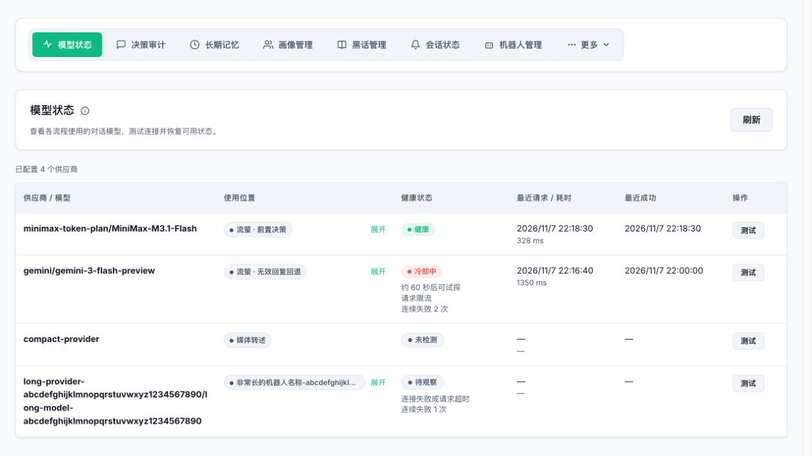
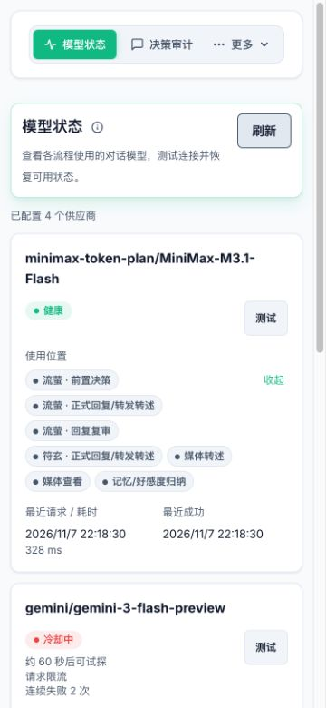

# Conversation model health

Open **模型状态 (Model status)** in Giftia WebUI to see configured providers, model names, usage, health, last request latency and last successful request. Configurations for disabled bots are included and labeled in the usage column. The tab is pinned by default. Use **更多 (More)** when space is limited, or customize navigation to move it.

Each provider/model has one displayed name. Usage stays on one line until **展开 (Expand)** is selected; use **收起 (Collapse)** to close it. Expanded usage stays open during automatic refreshes. Phones and other narrow screens use cards with wrapping names, health, request times and a test button.

Decisions, formal replies, invalid-output fallback, reply review, image/audio/video captions, sticker analysis, media inspection, memory and affinity summaries, and forwarded-message summaries share one in-memory health tracker keyed by AstrBot `provider_id`. Different configurations with the same model name have independent health. Provider configuration and ordering are preserved. Embeddings, reranking and TTS are outside this conversation-model view.

## Automatic cooldown and recovery

- Two consecutive recognized connection failures, model request timeouts or server-side 5xx errors start a 60-second cooldown. A successful request clears the failure counter.
- Rate limits start cooldown immediately and honor upstream `Retry-After`. Recognized authentication, missing-model, credit and quota errors use at least ten minutes.
- Every flow skips cooling providers and moves to the next provider in its **current list**. A skipped call consumes no API request or token record and does not trigger invalid-output fallback.
- After cooldown, the provider becomes eligible for one recovery probe using the next real request. Concurrent calls cannot run additional probes. Success restores availability. Failed probes extend cooldown to two, five and ten minutes. The calculated cooldown is capped at ten minutes; longer upstream delays are honored.
- Idle providers are not actively polled. Provider instance or configuration changes are checked on the next request. Restarting the plugin clears runtime health history.

Empty output, invalid XML/JSON, safety refusals, bad request parameters, context limits and local processing errors do not establish a provider outage. Health is updated at the model request boundary, before business parsing. Errors after native tool execution starts are excluded from this model's failure counter, and the existing protection against replaying tool effects remains in place.

Health admission precedes existing retry rules: request errors stay within the current list, invalid primary replies enter the separate fallback list, and invalid fallback replies end the reply. An empty fallback configuration preserves legacy output handling. If no candidate is available, each flow keeps its existing failure behavior; unavailable reply reviews still allow the draft through.

## Connectivity tests

Click **测试 (Test)** to send a short request asking for `OK`, with a 30-second timeout. Tests bypass cooldown, use no tools or conversation history, and share the single recovery-probe slot.

A nonempty text reply immediately clears failures and cooldown for every flow. Empty output or an exception does not restore health. This tests text generation, not multimodal capabilities or business XML formatting.

The visible page refreshes about every five seconds and has a manual refresh button. Test requests are recorded under token usage type `provider_test`. The page exposes classified failure reasons, not API keys or raw exceptions.
