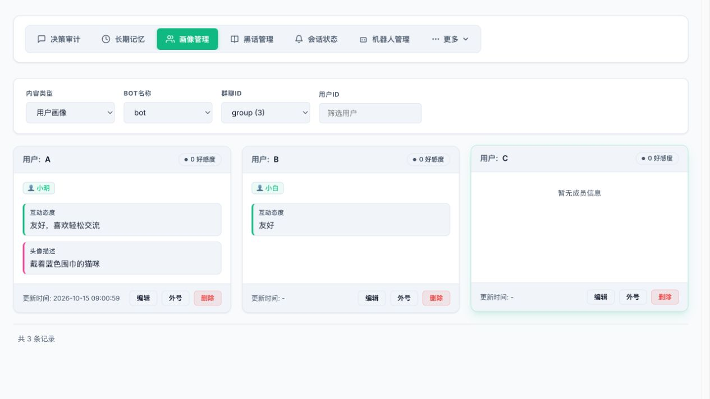

# 原子记忆管理

在 AstrBot 插件页面打开 Giftia WebUI，进入“长期记忆”。每条记录保存一项事实，不再区分记忆类型或维护有效、完成、取消等状态。

1. 选择 Bot 和会话，按关联群友或内容筛选。关联群友使用完整账号精确匹配，点击卡片上的成员标签也能筛选。
2. 正文说明参与群友、各自行为、互动方向及获知方式。主题以加粗标题显示，重要度位于右上角；人工录入或修订标记显示在标题下方。事实时间在正文后展示，创建时间和命中次数位于底部；展开“查看依据”可阅读原话及媒体转述。
3. “新增记忆”填写全部关联群友账号、主题、重要度和文本，支持多人参与。新增后定位到对应会话，记录标为人工录入，不伪造聊天证据。
4. “编辑”可修改内容、重要度和关联群友，主题与原话依据保留，记录标为人工修订。后台修改过的条目需要刷新后重新编辑。
5. “清理记忆”继承当前会话、关联群友及内容条件，先预览候选再选择删除。

| 原入口 | 现在的入口 |
| --- | --- |
| 记忆类型、状态筛选及约定状态编辑 | 已移除，变化与约定时间直接写入事实正文 |
| `/整理记忆`、新增后的关联整理 | 已移除，不再创建或消费整理批次 |
| 主体、对象字段 | 合并为关联群友账号列表，角色和互动方向由正文说明 |
| 来源分类筛选 | 已移除，自述和观察由正文说明，原话证据仍可展开 |
| 自身的“记忆查询与删除”工具 | 改为“记忆查询”，删除由管理页及管理员命令处理 |
| 画像中的关键约定、性格、兴趣、补充与关系头衔 | 有直接依据的内容作为独立事实保存 |
| 称呼、外号、互动态度、好感度、头像描述 | 继续在画像管理维护 |
| 近期记忆直接注入、启用会话召回池开关 | 统一使用会话召回池；注入记忆数量设为 0 可关闭自动检索与自动注入 |

成员卡片原来的“画像／关系”子页签已取消，保留信息直接展示。卡片不展示近期记忆；请在“长期记忆”按用户账号筛选相关记录。

旧画像字段仍保留在数据库中，用户画像报告不再读取和展示性格风格、兴趣话题、其他补充、关键约定和关系称谓。自定义报告模板若仍引用旧变量，需删除相应内容或恢复默认模板。

事实归纳由“启用被动状态维护”和“被动总结模型提供商”控制，管理员可执行 `/强制总结` 处理一批已见且未归纳的消息。归纳只记录本批消息中的新事实，不检索、合并、替代或改写历史记忆，不自动推断长期习惯。偏好变化和约定的履行、取消作为新的事实记录，明确的约定及截止时间写入正文。

实际提交给决策或回复模型的消息，以及 Bot 自身成功发送的消息，都算已见。模型上下文包含本轮回溯历史和当前批次，决策选择不回复也算已见；Bot 输出在发送成功并入库后立即标记，无需等待下一轮读取。其他消息单纯入库不算已见。再次唤醒时，只把本次上下文实际读取的历史加入待归纳集合，保留中间始终未见的消息空档；已经归纳的消息再次读取不会重复归纳。所有自动触发入口和 `/强制总结` 共用这一范围。

归纳输入包含当前 Bot、当前会话中本批发言群友的账号、昵称和称呼映射。正文优先使用 Bot 对群友的称呼，没有则使用昵称，仍不可用时使用账号；同名时补充账号区分。关联用户字段始终保存完整账号，原始发言和证据不会被称呼替换。

归纳模型只通过 `source_id` 引用消息，程序自动将该消息的直接发言及已完成的可用媒体转述合并为一份证据快照，同时保存发言账号、时间、消息标识和媒体标识；模型无需选择媒体或复述原文。一条消息包含多个媒体仍算一份来源。引用和转发中的嵌套内容不作为直接发言，撤回消息、操作日志、指令及不可用媒体不能作为依据，机器人发言不能独立证明用户事实。

归纳触发时机由“被动总结静默触发阈值”和“被动总结溢出触发阈值”控制，溢出只统计已见且离开上下文窗口的待归纳消息。每批最多 100 条消息，按约 16000 字符划分完整消息。事实、批次去重标记和本批消息的完成状态在同一事务保存；模型失败或校验不通过时保留待处理状态，可再次触发或执行 `/强制总结` 重试。后台每 5 分钟检查一次：会话存在已见待归纳消息，且最后一条消息距今至少 5 分钟时补处理，允许 Bot 当前不活跃。从未见过消息的会话不会因此启动归纳，锁被占用也不会创建归纳资格。巡检同时重试可选向量索引，索引失败不丢失已经保存的事实。

决策审计中的“已归档消息边界 ID”改为“已归纳消息最大 ID”，每条消息分别显示“未见”“已见待总结”或“已总结”；最大 ID 不再表示此前所有消息都已处理。历史记录清理会保护已见待总结消息，包括 ID 小于该值、后来才被回溯读取的消息。升级时保留旧进度内的已处理状态，其余旧消息默认未见，不因旧的待总结标记自动归纳；新状态可跨重启保留。对于曾被误标为未见的 Bot 自身输出，升级时依据各会话已保存的观察者账号修正为待总结，保留群友的未见状态和已经总结的消息。

旧记忆正文和证据继续保留，不会伪造缺失的依据。新建数据库不包含记忆类型、状态、到期状态或整理进度字段；已有数据库中的多余字段和旧整理批次不再使用，初始化不删除或重建历史数据。归纳输出采用当前 JSON Schema，只包含事实相关字段和消息依据。

决策模型可以请求检索；启用嵌入后，正式回复继续使用会话召回池。旧配置中的 `session_recall_enabled` 不再生效；`/读取近期记忆` 命令继续可用。

自动召回只在回复首轮执行：本批待回复消息按 `user_id` 分组，按原顺序合并同一用户的发言后分别检索，回复提示词中的聊天顺序不变。媒体只在原位置使用已有、已完成转述的 `caption`，不加入 `text`、类型、角色或来源字段；无可用 caption 的媒体跳过，普通文本仍保留，整组为空时不检索。各用户分别按自己的查询重排，合并后按记忆 ID 去重，同一记忆每批只记录一次自动召回命中。每位用户候选条数由“每位用户候选召回数量”控制；本轮自动召回与会话池历史记忆合计受“注入记忆数量”限制，当前结果优先。该数量设为 0 时关闭自动检索与自动注入，决策及工具显式查询继续可用。回复成功后才将本批召回提交到会话池，池内 TTL 与容量淘汰继续生效。

所有召回入口由同一个构建函数注入事实正文及明确的事件时间；旧记录中的观察时段继续保留。事件时间不明时只显示创建时的记录时间，不使用编辑更新时间代替。提示词不注入记忆类型、状态、记忆 ID、关联账号列表或证据原文；内部仍按 ID 去重，显式查询结果优先于会话池中的副本。回复模型保留 `<search_memory>`，不提供或执行 `<delete_memory>`。

本次精简沿用现有语义检索、可选重排、会话池 TTL 和容量限制，不增加重要度与时间衰减，也不补充检索同一事实的后续变化。

定期历史清理及按自动清理配置立即执行的操作，会保留各 Bot、会话尚未越过持久化记忆处理游标的消息。游标缺失或无效、归纳失败及处理中批次不会放行待处理来源；已处理批次仍受保留天数、条数与最少近期消息限制。记忆内的证据快照独立保存，原聊天记录清理后仍可查看。
