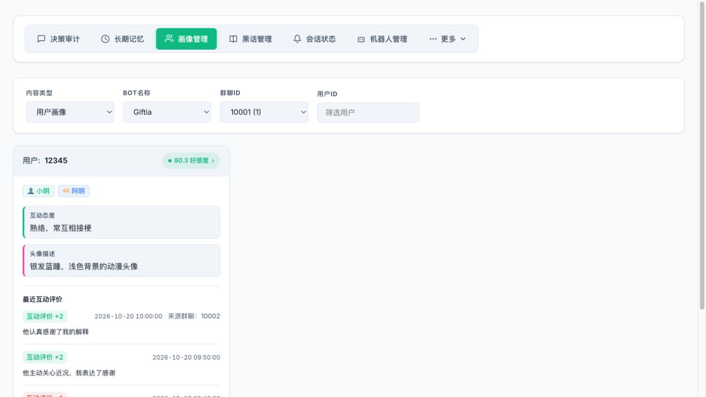
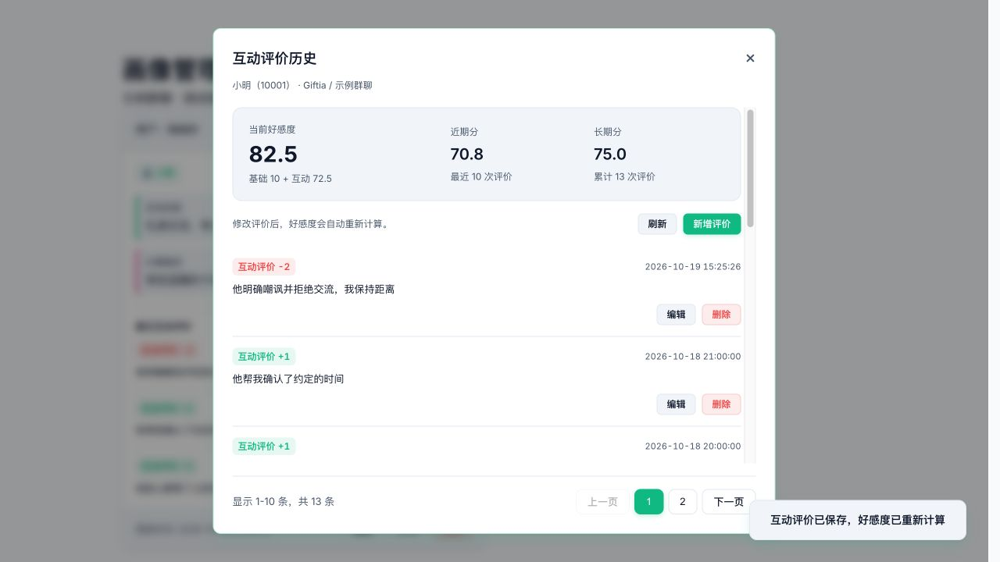
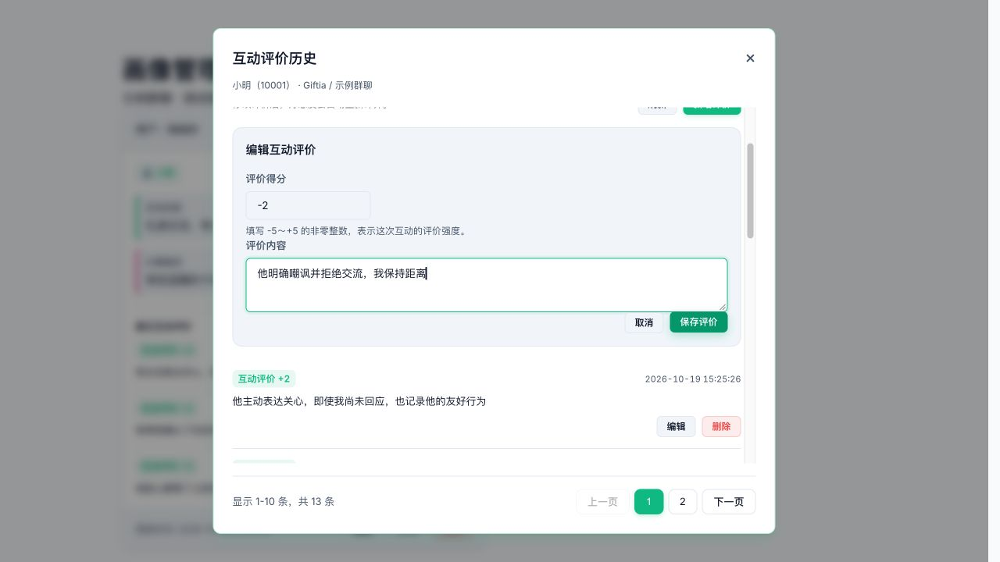
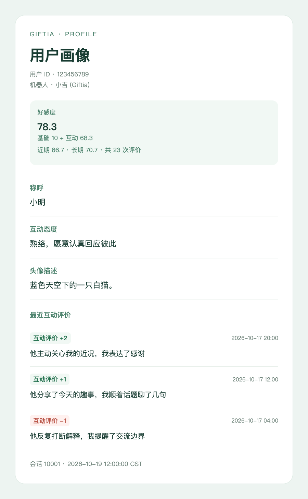

# 原子记忆管理

在 AstrBot 插件页面打开 Giftia WebUI，进入“长期记忆”。每条记录保存一项事实，不再区分记忆类型或维护有效、完成、取消等状态。

1. 选择 Bot 和会话，按关联群友或内容筛选。关联群友使用完整账号精确匹配，点击卡片上的成员标签也能筛选。
2. 正文说明参与群友、各自行为、互动方向及获知方式。主题以加粗标题显示，重要度位于右上角；人工录入或修订标记显示在标题下方。事实时间在正文后展示，创建时间和命中次数位于底部；展开“查看依据”可阅读原话及媒体转述。
3. “新增记忆”填写全部关联群友账号、主题、重要度和文本，支持多人参与。新增后定位到对应会话，记录标为人工录入，不伪造聊天证据。
4. “编辑”可修改内容、重要度和关联群友，主题与原话依据保留，记录标为人工修订。后台修改过的条目需要刷新后重新编辑。
5. “清理记忆”继承当前会话、关联群友及内容条件，先预览候选再选择删除。

| 原入口 | 现在的入口 |
| --- | --- |
| 记忆类型、状态筛选及约定状态编辑 | 已移除，变化与约定时间直接写入事实正文 |
| `/整理记忆`、新增后的关联整理 | 已移除，不再创建或消费整理批次 |
| 主体、对象字段 | 合并为关联群友账号列表，角色和互动方向由正文说明 |
| 来源分类筛选 | 已移除，自述和观察由正文说明，原话证据仍可展开 |
| 自身的“记忆查询与删除”工具 | 改为“记忆查询”，删除由管理页及管理员命令处理 |
| 画像中的关键约定、性格、兴趣、补充与关系头衔 | 有直接依据的内容作为独立事实保存 |
| 按群保存的称呼、互动态度、头像描述、基础分和好感度 | 同一 Bot 按用户共享，外号及次数仍按群维护 |
| 直接编辑累计好感度 | 改为编辑“好感度基础分”；最终分由基础分与互动分相加 |
| 好感度变化历史、好感度前后值 | 改为“互动评价历史”，仅展示时间、评价强度和理由 |
| 卡片上的好感度构成、评价计数 | 点击卡片顶部的好感度，在弹窗中查看 |
| 近期记忆直接注入、启用会话召回池开关 | 统一使用会话召回池；注入记忆数量设为 0 可关闭自动检索与自动注入 |

画像、称呼、头像描述、互动态度和关系数据按“Bot＋用户”共享，不同 Bot 保持独立。按群筛选只选择该群关联的用户和外号，不再隔离画像与好感度。升级时各群基础分取最高值（全部为负数时仍取其中最高值），其余文字字段逐项取最近更新的非空值，互动态度清空并重置评估进度，后续按原有阈值重新评估。各群独立互动全部保留原 ID、评价值和来源，不做跨群去重；迁移只执行一次，重启不会再次清空态度。

成员卡片顶部展示最终好感度，基础分、互动分、近期分、长期分和评价计数统一在好感度弹窗中查看。卡片下方展示最近三次互动评价，按最新在前排列，包含时间、评价强度和理由，非本群记录额外标注来源群聊或私聊；不足三次时展示已有记录，没有历史时隐藏整个“最近互动评价”区域。卡片不展示近期记忆；请在“长期记忆”按用户账号筛选相关事实。



点击卡片顶部的好感度药丸，打开“互动评价历史”弹窗。顶部展示该成员在当前 Bot 下跨群共享的最终好感度、基础分与互动分构成，以及近期分、长期分和各自的评价计数。下方每页固定 10 条历史记录，可通过页码或上一页、下一页翻页，底部显示记录范围与总条数；末页只显示剩余记录。没有历史时仍可查看分数构成，记录区显示空状态。历史浏览不受后台评估最多 50 条的上下文窗口限制。加载失败时可点击“重试”。



在同一弹窗中点击“新增评价”添加记录，或点击某条记录的“编辑”修改评价内容和得分。得分为 -5～+5 的非零整数，内容为 1～120 字；新增记录使用当前时间，编辑保留原始发生时间及来源。点击“删除”并确认可移除记录，末页删空后自动返回剩余的最后一页。保存或删除后，当前好感度、各窗口分数、计数、成员卡片和查询工具均按现有公式读取修订后的历史；基础分保持不变。历史版本冲突会阻止覆盖其他人的修改，点击“刷新”后再编辑。



修改历史会重置该成员的互动态度评估进度，并使进行中的旧版本评估失效；后续仍按原有评价数量和强度阈值重新评估，已有互动态度在评估前保留。后台评估根据修订后的跨群评价重新计算窗口内分数；数据库、接口和报告模板数据已移除冗余的好感度前后快照。

旧画像字段仍保留在数据库中，用户画像报告不再读取和展示性格风格、兴趣话题、其他补充、关键约定和关系称谓。自定义报告模板若仍引用旧变量，需删除相应内容或恢复默认模板。

画像查询工具 `search_user_profile` 的 `query` 按当前 Bot 共享的用户 ID、你的称呼和头像描述模糊匹配，也可通过当前会话昵称和外号定位，不再匹配旧画像字段或互动态度。结果保留当前画像及好感度，并为每位匹配成员附上互动评价历史，跨群展示时间、评价强度和理由，并标注非本群来源。可选 `page` 从 1 开始，每页固定 10 条，最新在前；不传时展示最近 10 条，超出末页时返回末页，没有记录时显示空状态。`limit` 仍控制匹配成员数，默认 5、最大 20，不影响历史页面大小。每位成员分别显示实际页码及历史总条数；匹配多人时，`page` 分别作用于各自的历史。例如 `{"query":"12345","page":2}` 查看该成员较早的第 11～20 条评价。`/画像` 对外报告仅展示当前会话最近三条，不包含其他群聊或私聊的互动记录。

好感度评价以群友实际面向 Bot 的行为为依据。Bot 主动搭话、示好或关心而用户未回应时，不得给予正向评价；有明确负面依据时才可负评，否则保持不变。用户主动向 Bot 示好、关心或提供帮助，即使 Bot 尚未回应，也可以给予正向评价。普通未回应、上下文不足或批次末尾暂未收到回应不能直接视为恶意冷落，也不补写后续反应。这些条件只限制互动评价方向，不修改最终好感度的计算规则。

用户画像报告的默认图片和文本响应均只展示当前会话最近三次互动评价，按最新在前排列；没有历史时省略整段，缺少内容的画像栏目也不展示“暂无记录”。有效的 0 分仍显示。报告模板数据中，空画像字段为 `""`，缺失的 `relation` 为 `null`，`profile_fields` 只包含有内容的栏目。自定义模板判断好感度是否存在时使用 ``，避免隐藏 0 分。

报告额外提供 `base_relation`、`interaction_score`、`recent_score`、`long_term_score`、`total_count` 和 `recent_count`。这些分数、总条数和近期样本数先按跨群完整记录计算，再筛选供展示的本会话明细；即使本会话没有记录，也保留同一用户的共享分数与统计。`relation` 是最终分，无历史时为基础分加50。

`recent_relation_changes` 数组最多包含当前会话的三条记录，其他会话记录及来源不进入报告模板数据；没有本会话历史时为 `[]`。每条展示互动评价强度 `delta`、`reason` 和便于展示的本地时间 `time`，另含原始时间 `occurred_at`、`created_at`；报告数据不提供来源字段 `group_or_user_id` 或 `source_label`，自定义模板也无法获取其他会话记录。Bot 自身回复上下文、查询工具及管理员历史查看继续读取共享历史。`relation_before` 和 `relation_after` 已从数据库、接口和报告数据中删除，自定义模板应改用 `delta` 展示互动评价。已保存的自定义模板不会被覆盖，可恢复默认模板使用新布局，或自行遍历该数组：

```jinja2

<p>{{ change.time }} · 互动评价 {{ '%+d' | format(change.delta) }}</p>
<p>{{ change.reason }}</p>

```



Bot 内部回复上下文和画像查询工具保留非本会话记录及来源，并明确约束不得在对外回复中披露或转述这些记录和来源。

最终好感度 = 基础分 + 互动分。基础分默认0，由管理员在“画像管理 → 编辑 → 好感度基础分”设置，可为负整数；作用域为当前 Bot 和用户，所有群聊与私聊共享。互动分初始50，范围0～100；最终好感度允许因基础分超过100或低于0。内部保留计算精度，界面、报告和提示词显示一位小数。

近期分使用跨群合计最近最多10条有效互动评价，长期分使用跨群全部已记录评价（包含最近10条）。对各窗口分别求正向分值总和 P 和负向分值绝对值总和 N，窗口分为 `100 × (5 + P) / (10 + P + N)`；互动分为 `近期分 × 60% + 长期分 × 40%`。中性的无变化聊天不进入样本，单次评价范围为-5～+5，0不记录。无历史时50表示中性、尚无明显倾向，不表示已熟悉；正式回复与决策的系统提示词统一说明一次好感度标准，用户提示词仅提供各用户的数据。正式回复结合评价条数、理由和记忆理解分数。

本次评价的 `delta` 表示互动方向和强度，不等于最终分增量。最近十条窗口滚动时，较强正向记录离开窗口，新的轻微正向评价也可能使最终分下降。历史保存原始互动评价、时间、理由和来源会话；管理员修改基础分不重写历史，不生成互动评价。旧累计值不再读取、不转换为基础分、不补造历史；没有历史的新起点为基础0加互动50。自定义角色中的旧分数阈值需按新刻度调整。

“互动态度”表示双方通常如何相处，例如“熟络，常互相接梗”。第一阶段每批维护外号及互动评价，已有画像仅提供外号，不注入当前分数或长期互动态度。维护提示词只描述互动行为的评价标准，不说明好感度计算规则。相同互动采用一致的评价标准，不按分值或资历收紧。系统保存具体理由、来源群或私聊、来源批次和时间；同一批次对同一成员只评价一次。正式回复为 `reply_messages` 中的每位发言用户分别注入画像，包含基础分、互动分、近期分、长期分、样本数和最近三条评价理由；同一用户只注入一次，不受活跃成员摘要数量限制，也不会在摘要中重复出现。原“最近10次／历史正向变化占比”由加权分数取代。决策画像提供最终分，不注入评价理由；活跃成员摘要仅保留最终分，不附计分标准、分数结构或评价理由。

每位成员累计五次未评估的有效变化，或单次互动评价绝对值达到4时，额外评估双方的互动基调。第二阶段读取共享互动态度及跨群最近最多 50 条变化，模型输入不包含来源群信息，只提供时间、评价、理由及新旧标记，并参考本批相关聊天；主要根据文字理由体现的实际互动判断，允许保持原有基调，不再修改好感度。评估成功后保存进度，包括“保持不变”；失败保留记录，由每 5 分钟的后台维护重试，无需新聊天。超过 50 条的积压分批评估，评估期间新增的记录留待后续处理。删除共享成员画像会删除该 Bot 下此用户的所有画像、互动历史和各群外号；清空某个会话只移除该会话的历史、外号和关联，保留共享画像、基础分及其他群数据。

事实归纳由“启用被动状态维护”和“被动总结模型提供商”控制，管理员可执行 `/强制总结` 处理一批已见且未归纳的消息。归纳只记录本批消息中的新事实，不检索、合并、替代或改写历史记忆，不自动推断长期习惯。偏好变化和约定的履行、取消作为新的事实记录，明确的约定及截止时间写入正文。

实际提交给决策或回复模型的消息都算已见，包含本轮回溯历史和当前批次，决策选择不回复也算已见。Bot 自身成功发送的消息仅在当前 Bot、当前会话处于活跃窗口或正在生成回复时，才在入库后立即标记；未活跃时的指令响应保持未见，后续实际进入决策或回复上下文时再标记。其他消息单纯入库不算已见。再次唤醒时，只把本次上下文实际读取的历史加入待归纳集合，保留中间始终未见的消息空档；已经归纳的消息再次读取不会重复归纳。所有自动触发入口和 `/强制总结` 共用这一范围。

归纳消息参考正式回复的 `<message>` 格式，只保留 `source_id`、`user_id`、可用的 `nickname` 和完整时间；存在回复对象时补充 `reply_to`。称呼复用正式回复的构建函数：优先使用当前 Bot 对该会话群友的称呼，否则保留每条消息的原昵称，均无可用值时通过 `user_id` 识别；不再重复注入称呼表、平台消息 ID、布尔标记和空数组。完整日期与时区用于跨日事件判断；撤回消息、操作日志及指令在构建时过滤。可用媒体也复用正式回复的嵌入与附注格式：描述字段总长度不超过 100 字且只出现一次时，在媒体标识后内嵌 `[描述:画面: ...; 文字: ...; 类型: ...; 人物: ...; 来源: ...]`，省略空字段；较长或重复的转述在 `<media_content>` 中按媒体 ID 去重，保留类型、人物、来源及文字属性，转述正文放在 `<caption>` 内。仅处理直接附带且已完成的可用转述。关联用户字段仍保存完整账号，原始发言和证据不会被显示称呼或媒体嵌入改写。

归纳模型只通过 `source_id` 引用消息，程序自动将该消息的直接发言及已完成的可用媒体转述合并为一份证据快照，同时保存发言账号、时间、消息标识和媒体标识；模型无需选择媒体或复述原文。一条消息包含多个媒体仍算一份来源。群友和 Bot 自身的消息均可作为依据，也可以只引用 Bot 回答的 `source_id`，不要求证据包含群友发言；仅有 Bot 消息的待处理批次同样参与归纳。引用和转发中的嵌套内容不作为直接发言，撤回消息、操作日志、指令及不可用媒体不能作为依据。

归纳触发时机由“被动总结静默触发阈值”和“被动总结溢出触发阈值”控制，溢出只统计已见且离开上下文窗口的待归纳消息。每批最多 100 条消息，按约 16000 字符划分完整消息。事实、批次去重标记和本批消息的完成状态在同一事务保存；模型失败或校验不通过时保留待处理状态，可再次触发或执行 `/强制总结` 重试。后台每 5 分钟检查一次：会话存在已见待归纳消息，且最后一条消息距今至少 5 分钟时补处理，允许 Bot 当前不活跃。从未见过消息的会话不会因此启动归纳，锁被占用也不会创建归纳资格。巡检同时重试可选向量索引，索引失败不丢失已经保存的事实。

决策审计中的“已归档消息边界 ID”改为“已归纳消息最大 ID”，每条消息分别显示“未见”“已见待总结”或“已总结”；最大 ID 不再表示此前所有消息都已处理。历史记录清理会保护已见待总结消息，包括 ID 小于该值、后来才被回溯读取的消息。升级时保留旧进度内的已处理状态，其余旧消息默认未见，不因旧的待总结标记自动归纳；新状态可跨重启保留。启动时不再仅依据机器人账号补标历史自身输出，保留已有的逐条观察状态，避免把未活跃时的指令响应加入总结。

旧记忆正文和证据继续保留，不会伪造缺失的依据。新建数据库不包含记忆类型、状态、到期状态或整理进度字段；已有数据库中的多余字段和旧整理批次不再使用，初始化不删除或重建历史数据。归纳输出采用当前 JSON Schema，只包含事实相关字段和消息依据。

决策模型可以请求检索；启用嵌入后，正式回复继续使用会话召回池。旧配置中的 `session_recall_enabled` 不再生效；`/读取近期记忆` 命令继续可用。

自动召回只在回复首轮执行：本批待回复消息按 `user_id` 分组，按原顺序合并同一用户的发言后分别检索，回复提示词中的聊天顺序不变。媒体只在原位置使用已有、已完成转述的 `caption`，不加入 `text`、类型、角色或来源字段；无可用 caption 的媒体跳过，普通文本仍保留，整组为空时不检索。各用户分别按自己的查询重排，合并后按记忆 ID 去重，同一记忆每批只记录一次自动召回命中。每位用户候选条数由“每位用户候选召回数量”控制；本轮自动召回与会话池历史记忆合计受“注入记忆数量”限制，当前结果优先。该数量设为 0 时关闭自动检索与自动注入，决策及工具显式查询继续可用。回复成功后才将本批召回提交到会话池，池内 TTL 与容量淘汰继续生效。

所有召回入口由同一个构建函数注入事实正文及明确的事件时间；旧记录中的观察时段继续保留。事件时间不明时只显示创建时的记录时间，不使用编辑更新时间代替。提示词不注入记忆类型、状态、记忆 ID、关联账号列表或证据原文；内部仍按 ID 去重，显式查询结果优先于会话池中的副本。回复模型保留 `<search_memory>`，不提供或执行 `<delete_memory>`。

本次精简沿用现有语义检索、可选重排、会话池 TTL 和容量限制，不增加重要度与时间衰减，也不补充检索同一事实的后续变化。

定期历史清理及按自动清理配置立即执行的操作，会保留各 Bot、会话尚未越过持久化记忆处理游标的消息。游标缺失或无效、归纳失败及处理中批次不会放行待处理来源；已处理批次仍受保留天数、条数与最少近期消息限制。记忆内的证据快照独立保存，原聊天记录清理后仍可查看。
