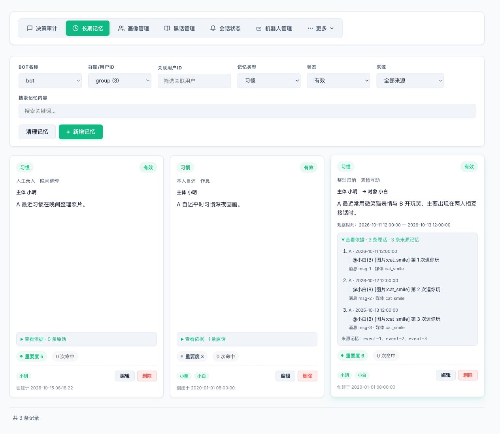

# 原子记忆管理

在 AstrBot 插件页面打开 Giftia WebUI，进入“长期记忆”。默认只显示有效记录；“全部状态”可查看已完成、取消、过期和被替代的历史。

1. 选择 Bot 和会话，再按类型、来源、用户或内容筛选。关联用户使用完整账号精确匹配，点击卡片上的成员标签也能筛选。
2. 习惯分为“本人自述”和“整理归纳”。卡片保留主体、对象、主题与观察时间，展开“查看依据”可阅读原话及来源记录。
3. “新增记忆”可选择五种类型并填写主体、对象、主题和文本；关系需要两个不同账号。只有约定可以设置到期时间，输入时间按浏览器本地时区保存。新增后定位到对应的人工录入记录。
4. “编辑”可修改内容、重要度和关联成员；有效约定可设为完成或取消。类型、主体、对象与原话依据保留，内容修改标为人工修订。后台修改过的条目需要刷新后重新编辑。
5. “清理记忆”继承当前类型、状态与来源条件，先预览候选再选择删除。

| 原入口 | 现在的入口 |
| --- | --- |
| 画像中的关键约定 | 长期记忆 → 约定，保留独立状态和期限 |
| 画像中的性格、兴趣、补充与关系头衔 | 不再维护固定标签；有证据的事实按事件、关系、偏好或习惯管理 |
| 称呼、外号、互动态度、好感度、头像描述 | 继续在画像管理维护 |

成员卡片原来的“画像／关系”子页签已取消，保留信息直接展示。卡片不展示近期记忆；请在“长期记忆”按用户账号筛选相关记录。

旧画像字段仍保留在数据库及兼容的报告模板中。旧版记忆显示来源为“旧版记录”，不会自动伪造原话证据。定期归纳和整理仍由后台配置与管理员指令 `/强制总结`、`/整理记忆` 控制。

以下截图使用虚构数据，展示本人自述、人工录入与整理归纳的区别。

聊天历史自动清理与按自动配置立即执行清理会保留归纳游标之后的待处理消息。缺少有效进度或归纳失败时不会越过保护边界；成功处理后再按时间、条数和最新消息保底条件清理。已保存在记忆内的证据摘录继续可用，清理原消息后仍可归纳习惯。
