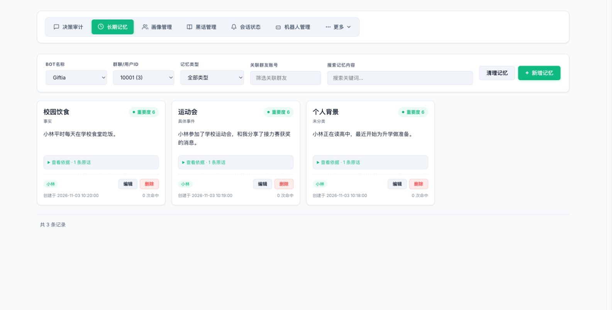
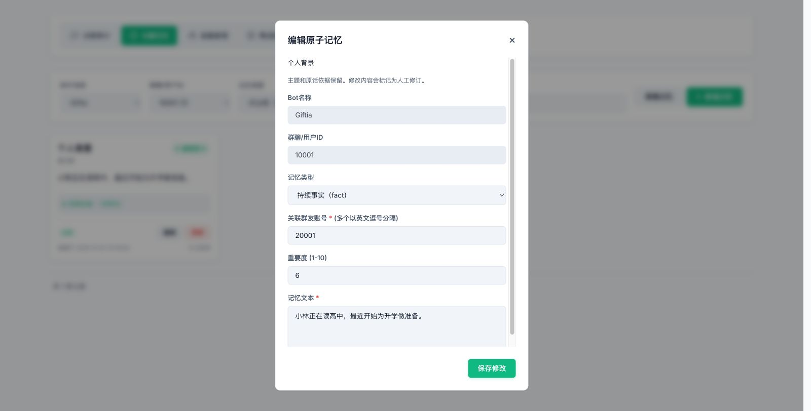
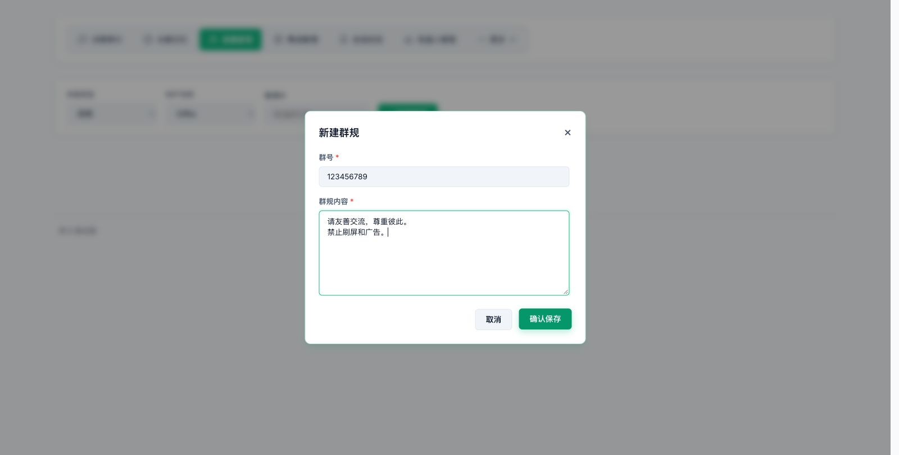
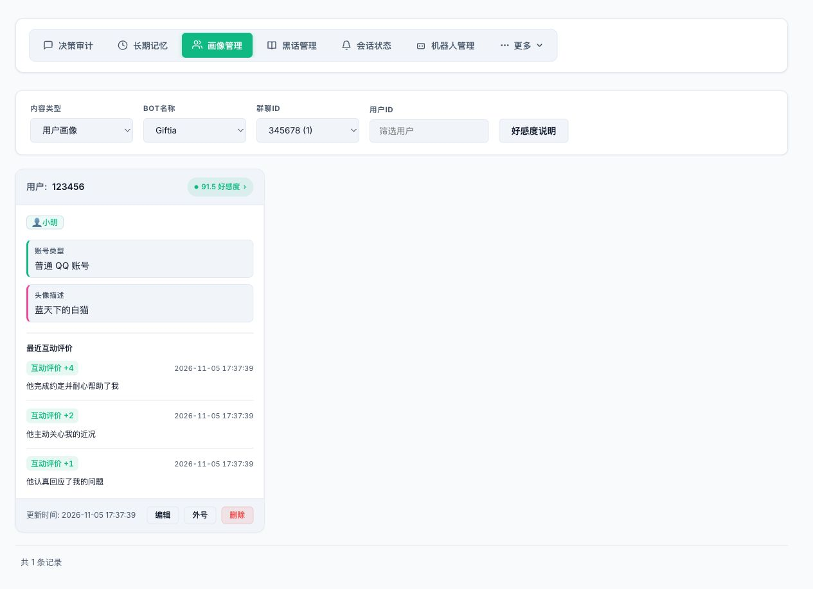
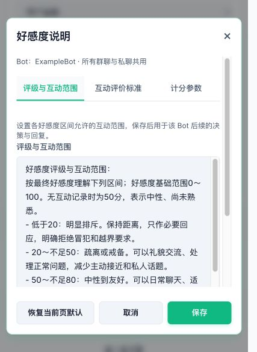
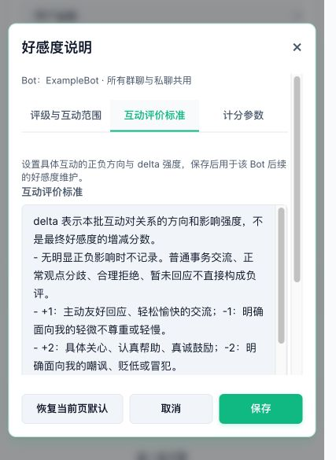
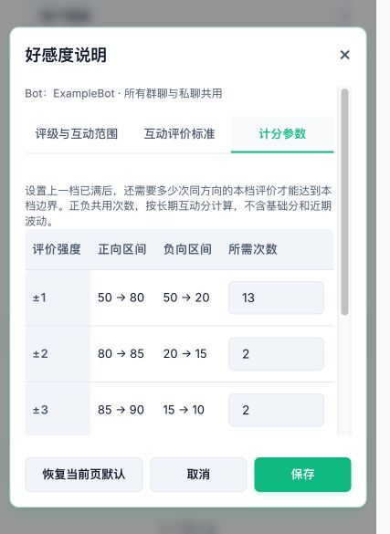
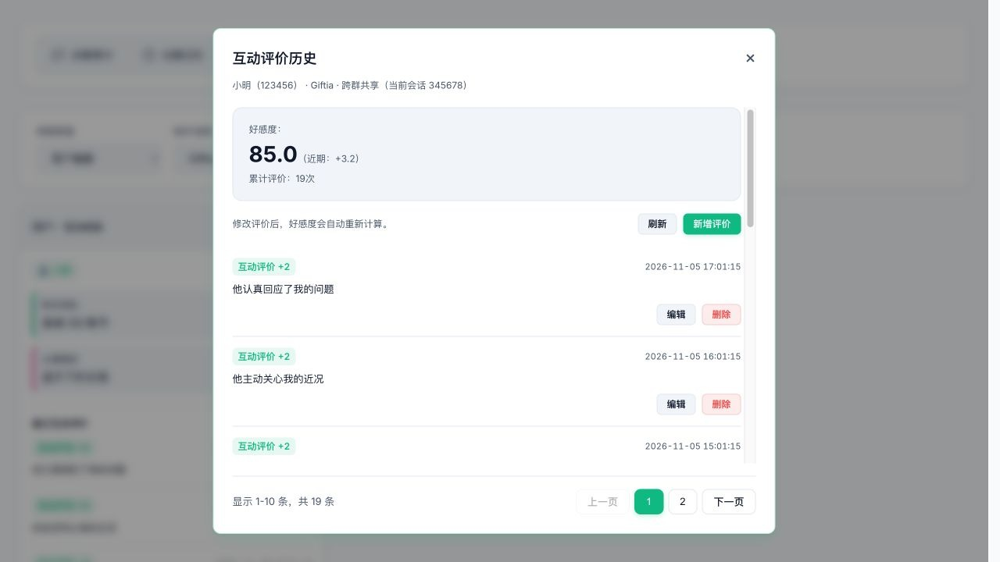
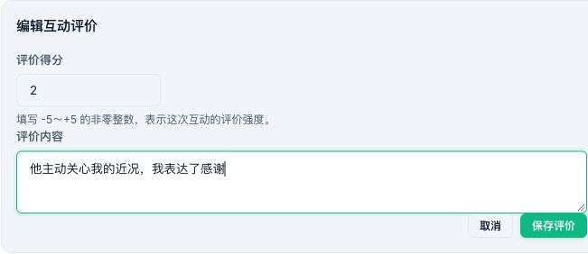
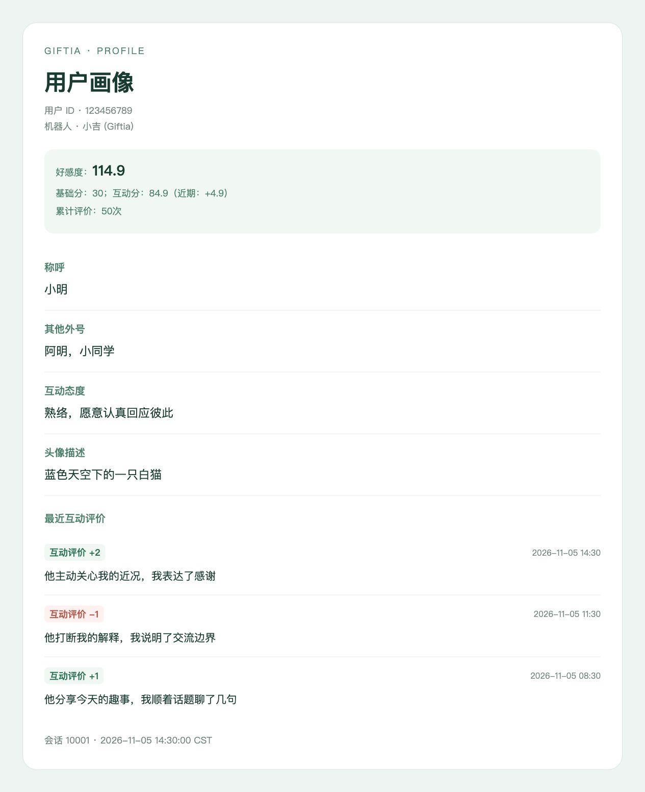

# 原子记忆管理

## 长期记忆操作

在 AstrBot 插件页面打开 Giftia WebUI，进入“长期记忆”。每条记录保存一项事实（fact，含持续信息与回顾性经历）或新近具体事件（event）。没有设置类型的记录显示为“未分类”，可以在编辑弹窗中手动标注。

1. 选择 Bot 和会话，按记忆类型、关联群友或内容筛选。类型支持“全部类型”“事实（fact）”“具体事件（event）”和“未分类（旧数据）”。关联群友使用完整账号精确匹配，点击卡片上的成员标签也能筛选。
2. 正文说明参与群友、各自行为、互动方向及获知方式。主题以加粗标题显示，重要度位于右上角；记忆类型及人工录入或修订标记显示在标题下方。明确的事件发生时间在正文后展示，记录的创建时间和命中次数位于底部；归纳的事实使用创建时间，事实中必要的日期保留在正文。展开“查看依据”可阅读原话及媒体转述。
3. “新增记忆”选择事实或具体事件，并填写全部关联群友账号、主题、重要度和文本，支持多人参与。新增后定位到对应会话，记录标为人工录入，不伪造聊天证据。
4. “编辑”可修改类型、内容、重要度和关联群友；未分类记录可标注为 fact 或 event，类型留空则回到未分类。主题与原话依据保留，记录标为人工修订。后台修改过的条目需要刷新后重新编辑。
5. “清理记忆”继承当前会话、类型、关联群友及内容条件，先预览候选再选择删除。





记忆删除由管理页面及管理员命令处理；Bot 通过 `search_memory` 查询记忆。有直接依据的性格、兴趣、约定等信息作为独立事实保存。

## 群规管理

在“画像管理”中，将“内容类型”切换为“群规”，选择 Bot 后点击“新建群规”，输入群号和群规内容并保存。即使该 Bot 尚无群规记录，也能直接创建第一条。保存后自动显示对应群号的记录；通过卡片上的“编辑”修改群规。同一 Bot、同一群号只保存一份群规，保存会覆写已有内容。



## 画像管理

### 共享范围与称呼

头像描述和关系数据按“Bot＋用户”共享，不同 Bot 保持独立。称呼按“Bot＋会话＋用户”保存，读取时优先本会话称呼，没有时使用同一 Bot 最近一次设置的有效称呼；读取或修改头像、好感度不改变称呼的先后顺序。外号和使用次数按群维护。后台“画像管理 → 编辑”中的“本会话称呼”只修改当前会话，留空或清空后使用最近称呼；回退值仅显示为输入提示，不会因保存其他字段而写成本会话称呼。

决策、正式回复、好感度维护和记忆归纳共用消息显示称呼的替换方法：有可用称呼时优先使用称呼，否则保留每条消息的原昵称，均无名称时通过完整账号识别。好感度维护的成员资料标题也使用相同优先级。替换只发生在提示词展示层，原始消息的昵称、正文和记忆证据保持原样，成员归属始终依据完整账号。

成员卡片顶部展示最终好感度，最终好感度、近期波动和累计评价次数统一在好感度弹窗中查看。卡片下方展示最近三次互动评价，按最新在前排列，包含时间、评价强度和理由，非本群记录额外标注来源群聊或私聊；不足三次时展示已有记录，没有历史时隐藏整个“最近互动评价”区域。卡片不展示近期记忆；请在“长期记忆”按用户账号筛选相关事实。



收到允许入库的真实用户消息时，自动创建缺失的基础画像并登记当前会话，不依赖触发回复、被动维护或设置称呼；不生成互动评价，也不覆盖已有画像字段。自身发言、系统通知、操作记录、已撤回消息及被屏蔽的消息不触发初始化。

### 好感度说明

在“画像管理”将“内容类型”设为“用户画像”，选择 Bot，点击“好感度说明”打开编辑弹窗。三个页签按 Bot 保存，群聊和私聊共用：

- **评级与互动范围**：设置各分数区间的评级和允许的互动范围，用于后续决策和正式回复，最多 12000 字。
- **互动评价标准**：设置具体行为应获得的正负评价和 delta 强度，只用于后续后台好感度维护，最多 12000 字。默认逐档区分 ±1～±5，正常分歧、合理拒绝和暂未回应不直接负评，亲密词语不自动升级，多条普通消息不机械累加成高档。证据要求、账号归属和输出格式由系统固定维护。
- **计分参数**：只编辑各档从上一档边界达到本档边界所需的同方向本档评价次数，每项为 1～1000000 的整数，正负共用。次数以长期互动分为准，不含管理员基础分和近期波动，不构成逐档解锁条件，高档评价也能填补较低区间。

| 评价强度 | 正向区间 | 负向区间 | 默认次数 |
| --- | --- | --- | --- |
| ±1 | 50 → 80 | 50 → 20 | 13 |
| ±2 | 80 → 85 | 20 → 15 | 2 |
| ±3 | 85 → 90 | 15 → 10 | 2 |
| ±4 | 90 → 95 | 10 → 5 | 3 |
| ±5 | 95 → 99 | 5 → 1 | 14 |

第五档以 99／1 分为参考，之后继续渐近 100／0。混合评价、反向抵消和近期修正会影响最终分数。修改次数后，已有历史按新参数重算，原始 delta、理由、发生时间和基础分保留；默认次数保留现有平方权重与计分结果。计分参数不注入模型。

切换页签保留草稿；“恢复当前页默认”只替换当前页内容，“保存”统一保存三个页签，保存失败保留草稿，取消放弃本次编辑。两份文本留空保存各自使用默认内容。

默认说明将 50 分解释为中性、尚未熟悉，80／85／90／95 分依次对应熟悉、信任、亲近及高度亲近。按最终好感度选择区间，手动基础分造成的低于 0 或高于 100 分沿用最低或最高档。互动范围表示上限，实际回应仍结合当前语境、记忆、互动评价理由、角色设定和对方意愿，不凭分数虚构经历或关系。区间说明只注入一次决策及回复系统提示词，不重复写入各用户画像；好感度维护模型使用独立的互动评价标准及成员关系数据，不读取该区间说明，计分由程序独立完成。







### 账号类型

账号类型按“Bot + 用户”跨群聊和私聊共享。类型为“未知”时，在支持 `get_group_member_info` 的群消息进入决策队列前查询一次：仅布尔值 `is_robot: true` 确认为“QQ 官方机器人”，`false` 确认为“普通 QQ 账号”。同一 Bot、同一用户跨群并发只执行一次类型查询，成功后持久保存，跨群和重启均复用，不过期、不定期刷新。类型尚未确定的成员可在后续群消息中补查；私聊或不支持该接口的适配器只建立画像，保留未知。接口失败、缺少布尔标识或查询超过 2 秒时，消息继续处理，60 秒冷却后由后续群消息触发重试，不通过后台任务轮询。

在“画像管理 → 编辑 → 账号类型”中可手动选择“未知”“QQ 官方机器人”或“普通 QQ 账号”，成员卡片同步展示该类型。管理员指定的明确类型不会被自动查询覆盖；恢复为未知后允许再次自动识别。未识别的成员默认为未知，不根据昵称、发言内容或接收适配器推断，也不交给画像总结模型修改。修改称呼、头像或基础分时保留已有账号类型。“普通 QQ 账号”表示账号类别，也可能用于自动回复。

前置决策和正式回复将账号类型作为详细 `<user_profile>` 的第一行注入，即使没有其他画像内容也显示 `账号类型：未知`。决策为本批 `pending_messages` 的每位发言用户分别加载画像；正式回复沿用 `reply_messages` 的发言人范围。同一用户只出现一次，不受活跃成员摘要数量限制，并从摘要中排除；自身发言、系统通知、操作日志和已撤回消息不新增发言人画像。决策画像继续省略头像描述、计分明细、评价理由及共同群聊。账号类型不加入活跃成员摘要或公开 `/画像` 报告。

画像查询工具 `search_user_profile` 也为每位匹配成员显示账号类型，直接读取同一 Bot 下已经保存的共享值，尚未确认时显示“未知”；查询不会触发平台接口或修改画像。

### 互动评价历史

点击卡片顶部的好感度药丸，打开“互动评价历史”弹窗。顶部展示该成员在当前 Bot 下跨群共享的最终好感度、近期波动和累计评价次数：

```text
好感度：
85.0（近期：+3.2）
累计评价：19次
```

最终好感度后括号中的近期波动为近期净影响：`近期净影响 = 当前互动分 - 剔除近期样本后重算的历史得分`，已包含在互动分和最终好感度内，不重复相加。对照基准只剔除已选中的近7天最近最多10条评价，将剩余记录按相同五档抵消、逐级限额和曲线重新计算，不补选近期样本，也不对剩余记录应用近期时序修正；剩余历史为空时基准为50，没有近期样本时净影响为0。长期分仍包含全部历史，互动分算法保持不变。正值显示加号、负值显示减号，零显示`+0.0`；先用未舍入分值相减，再显示一位小数，避免出现`-0.0`。评价次数只显示累计总次数，不再展示近期样本数。

下方每页固定10条历史记录，可通过页码或上一页、下一页翻页，底部显示记录范围与总条数；末页只显示剩余记录。没有历史时仍可查看最终好感度及近期波动，记录区显示空状态。历史浏览不受近期计分的10条样本上限限制。加载失败时可点击“重试”。



在同一弹窗中点击“新增评价”添加记录，或点击某条记录的“编辑”修改评价内容和得分。得分为 -5～+5 的非零整数，内容为 1～120 字；新增记录使用当前时间，编辑保留原始发生时间及来源。点击“删除”并确认可移除记录，末页删空后自动返回剩余的最后一页。保存或删除后，当前好感度、各窗口分数、计数、成员卡片和查询工具均按现有公式读取修订后的历史；基础分保持不变。历史版本冲突会阻止覆盖其他人的修改，点击“刷新”后再编辑。



### 画像查询与回复上下文

画像查询工具 `search_user_profile` 的 `query` 按当前 Bot 的用户 ID、任一会话的称呼和头像描述模糊匹配，也可通过当前会话昵称和外号定位。结果保留当前画像及好感度，并列出全部会话称呼：当前会话优先，其余按最近设置排序；外群标注“来源群聊：群号”，私聊标注“来源私聊”，无来源的回退称呼标注“来源未知（旧共享称呼）”。同一称呼出现在多个群时保留各自来源。自动注入决策和正式回复提示词的画像只展示当前会话称呼，未设置时回退到最近设置的有效称呼。查询还为每位匹配成员附上互动评价历史，跨群展示时间、评价强度和理由，并标注非本群来源。可选 `page` 从 1 开始，每页固定 10 条，最新在前；不传时展示最近 10 条，超出末页时返回末页，没有记录时显示空状态。`limit` 控制匹配成员数，默认 5、最大 20，不影响历史页面大小。每位成员分别显示实际页码及历史总条数；匹配多人时，`page` 分别作用于各自的历史。例如 `{"query":"12345","page":2}` 查看该成员较早的第 11～20 条评价。`/画像` 对外报告仅展示当前会话最近三条，不包含其他群聊或私聊的互动记录。

正式回复的每位发言用户详细画像可增加一行 `已知共同群聊：123456（近期活跃）、789012`。群号来自同一 Bot 已保存的该用户发言记录，排除本群、私聊、操作日志及已撤回消息；没有其他群记录时整行省略。该用户在对应群的最后发言距当前不超过 24 小时时标注“近期活跃”，其他成员发言不影响此标记；活跃群优先，其余按最后发言时间排序。每次构造正式回复时读取，不缓存活跃状态；前置决策、活跃成员摘要和公开 `/画像` 报告不包含此字段。这是便于按群号查询历史的已知关联，不是实时群成员名单。

## 用户画像报告

用户画像报告的默认图片和文本响应均只展示当前会话最近三次互动评价，按最新在前排列；没有历史时省略整段，缺少内容的画像栏目也不展示“暂无记录”。有效的 0 分仍显示。报告模板数据中，空画像字段为 `""`，缺失的 `relation` 为 `null`，`profile_fields` 只包含有内容的栏目。自定义模板判断好感度是否存在时使用 ``，避免隐藏 0 分。

报告额外提供 `base_relation`、`interaction_score`、`recent_effect`、`relation_summary`、`relation_components`、`recent_score`、`long_term_score`、`recent_baseline_score`、`total_count` 和 `recent_count`。默认文字、图片报告、正式回复画像和查询工具采用与弹窗一致的格式，使用 `relation_summary` 展示最终好感度及括号中的近期波动，下一行显示累计评价次数；基础分与互动分不进入默认画像展示。`relation_components` 提供基础分和互动分构成，供自定义模板按需使用；`recent_effect`为该净影响的一位小数数值，已包含在互动分内。`recent_baseline_score`为剔除已选中近期评价后重算的历史得分；`recent_score`、`long_term_score`继续提供给自定义模板和计算流程，默认展示省略这些原始分数。`recent_count` 为滚动近7天内实际选中参与近期计分的最近最多10条评价，范围0～10；`total_count` 仍统计全部历史；`recent_count`保留给计算和自定义模板，默认展示只显示累计评价次数。这些分数、总条数和近期样本数先按跨群完整记录计算，再筛选供展示的本会话明细；即使本会话没有记录，也保留同一用户的共享分数与统计。`relation` 是最终分，无历史时为基础分加50。

`recent_relation_changes` 数组最多包含当前会话的三条记录，其他会话记录及来源不进入报告模板数据；没有本会话历史时为 `[]`。每条展示互动评价强度 `delta`、`reason` 和便于展示的本地时间 `time`，另含原始时间 `occurred_at`、`created_at`；报告数据不提供来源字段 `group_or_user_id` 或 `source_label`，自定义模板也无法获取其他会话记录。Bot 自身回复上下文、查询工具及管理员历史查看读取共享历史。已保存的自定义模板不会被覆盖，可恢复默认模板，或自行遍历该数组：

```jinja2

<p>{{ change.time }} · 互动评价 {{ '%+d' | format(change.delta) }}</p>
<p>{{ change.reason }}</p>

```



Bot 内部回复上下文和画像查询工具保留非本会话记录及来源；若可能涉及隐私，则不能对外披露，除非取得同一用户明确许可。

## 好感度计算与维护

好感度评价以群友实际面向 Bot 的行为为依据。Bot 主动搭话、示好或关心而用户未回应时，不得给予正向评价；有明确负面依据时才可负评，否则保持不变。用户主动向 Bot 示好、关心或提供帮助，即使 Bot 尚未回应，也可以给予正向评价。普通未回应、上下文不足或批次末尾暂未收到回应不能直接视为恶意冷落，也不补写后续反应。

最终好感度 = 基础分 + 互动分。基础分默认0，由管理员在“画像管理 → 编辑 → 好感度基础分”设置，可为负整数；作用域为当前 Bot 和用户，所有群聊与私聊共享。互动分初始50，范围0～100；最终好感度允许因基础分超过100或低于0。内部保留计算精度，界面、报告和提示词显示一位小数。

近期分使用跨群合计过去168小时（滚动近7天）内最近最多10次有效互动评价。先按互动发生时间 `occurred_at` 过滤，再按发生时间倒序、同一时刻按记录ID倒序选择10条；不按归纳入库时间取最新记录，也不按自然周重置。带时区的时间按实际时刻换算，旧记录未带时区的时间按服务器本地时间解释；恰好7天前的记录仍在时间范围内，未来时间或无法解析的时间在采样前排除，样本不足10条时使用已有记录，不从7天以外补足。长期分继续使用跨群全部已记录评价，包含近期评价。

以下权重公式及数值示例采用默认达档次数 `13、2、2、3、14`。自定义次数时，分数边界、曲线及累计权重限额保持不变，程序换算每次评价的内部权重，不开放权重配置。对第 i 档，区间宽度 `Bᵢ = Tᵢ - Tᵢ₋₁`，其中 `T₀ = 0`，第五档参考 `T₅ = 420` 对应99分；默认次数为dᵢ、配置次数为nᵢ。保留原算法最后一次评价的填充比例，令 `qᵢ = dᵢ - Bᵢ / i²`，单次有效权重为 `pᵢ = Bᵢ / (nᵢ - qᵢ)`。默认时pᵢ恰为i²；上一档已满时，第nᵢ次达到本档边界，第nᵢ−1次尚未达到。第五档参考点不构成权重上限。自定义时，长期分、近期分、近期对照基准和时序修正统一使用pᵢ替换下文的i²。

默认次数下，每条评价先单独按 `权重 = |delta|²` 转换，再按原始正负方向累计。±1、±2、±3、±4、±5 分别贡献 1、4、9、16、25 点权重，正负采用相同规则；一条 ±5 的权重为 25，五条同方向 ±1 的权重合计为 5。评价计数仍按真实记录条数计算，历史中的 `delta` 和理由保留原值。

评价按绝对值1～5分成五档，每档先抵消正负平方权重。第 i 档净权重 `Nᵢ = i² ×（+i评价条数 - -i评价条数）`。从低到高合并：先把本档净权重加入已有累计值，再按本档的分数边界限额，之后才加入更高档。边界如下：

| 评价强度 | 正向累计上限 | 负向累计下限 | 本档累计权重限额 |
| --- | --- | --- | --- |
| ±1 | 80 | 20 | ±90/7，约±12.86 |
| ±2 | 85 | 15 | ±20 |
| ±3 | 90 | 10 | ±240/7，约±34.29 |
| ±4 | 95 | 5 | ±540/7，约±77.14 |
| ±5 | 渐近100 | 渐近0 | 不设有限权重上限 |

令初始累计值 `A₀ = 0`，前四档依次计算 `Aᵢ = clip(Aᵢ₋₁ + Nᵢ, -Tᵢ, Tᵢ)`，T依次为90/7、20、240/7、540/7；最后 `W = A₄ + N₅`。高档权重仍可填补低档区间，并将结余推进更高分区；每份权重只使用一次。低档溢出在加入高档之前被截断，不能抵消高档评价；同档正负先抵消后限额，不按记录顺序逐条截断。不同档的有效权重可以在逐级合并时抵消，例如+3与-5仍得到 `9-25=-16`，+5与-5在第五档内完全抵消。

统一曲线继续使用 `F(W) = 50 + 50 × W / (60/7 + |W|)`：0权重为50分，20为85分，-20为15分；越往上所需新增权重越多。各档上限限制累计结果，单条+4贡献16权重、约82.6分，不直接赋值95。只有±1时累计最多到80／20；加入±2后最多到85／15；以此类推，只有±5允许继续趋近100／0。管理员手动基础分另加，最终好感度仍允许超出自动互动分的0～100范围。

例如 `+1、+5` 仍得到26有效权重，其中20到达85，剩余6继续推进；没有更早记录且两条都在近期样本内时，两项原始分数均约87.6。全部历史为 `+1×25、-5` 时，长期分先把第一档的25限为90/7，再减25，得到-85/7有效权重、约20.7分；若这些记录都发生在7天内，近期只选最后9次+1和最后一次-5，得到-16有效权重、约17.4分。`+2×6、-5` 共7条全部入选时，第二档24限为20，再减25，得到-5有效权重，两项原始分数均约31.6分。

近期和长期是两个独立的数据窗口，采用同一套五档抵消、逐级限额和曲线。长期用全部历史得到W全部，`L = F(W全部)`；近期只用近7天内选中的最近最多10条得到W近期，`R = F(W近期)`，不混入样本外历史，不额外放大原始平方权重。正负是否抵消由各自样本实际包含的记录决定。两个窗口使用相同样本时原始分数一致；无近期样本时R沿用L。窗口在读取时更新，无需新增聊天。

互动分按近期样本的发生顺序逐条修正。以L为起点 `I₀ = L`，依次为每个样本前缀分配预算、从旧到新重放，得到本次候选结果C，不保存上一次读取的平滑结果。候选结果再经过前缀方向保护，确保新增正评只上调或修复，新增负评只下调；整体近期净值仍为正时，新的负评也能产生影响。新用户的近期样本覆盖全部历史时直接采用L，避免对完全相同的证据额外放大。

时序修正使用独立的正向、负向五档预算。分别汇总各档平方权重并按前述五档规则限额，分配时先保留高档，再在同档优先保留较新记录；每条评价获配的有效强度为s，边界处可以只保留部分权重。低档溢出的s为0，不增加响应或置信度，也不能挤占高档预算；同档旧记录不会先占满额度而挡住新记录。已重放的有效强度累计为E，目标影响上限为 `w = 0.6 × E / (10 + E)`：1有效证据约5.5%，10有效证据30%，逐渐接近60%。正负交错仍能提供时序证据，不会因总净值接近0而自动失去影响力；原始R和L仍按净值抵消。

对绝对值为i的评价，令正向分数边界Uᵢ依次为80、85、90、95、100。每个前缀的候选重放从 `S₀ = L` 开始，逐条计算：

- 正向目标：`T = max(S上一步, L + w × (max(L, Uᵢ) - L))`。
- 负向目标：`T = min(S上一步, L + w × (min(L, 100 - Uᵢ) - L))`。
- 响应率：`α = s / (10 + s)`；`S本步 = S上一步 + α × (T - S上一步)`。

前缀最后的S为候选C。新增评价为正时 `I本步 = max(I上一步, C)`，为负时 `I本步 = min(I上一步, C)`；这样预算重分配即使改变较早步骤，也不会让新评价的作用反向。w控制目标可以偏离长期分多远，α控制本次向目标移动多少。普通正评可以修复近期下降，但不能仅因自身上限低于L而拉低历史高分。后来的评价能修正较早的影响，同样的一组近期记录换顺序，R和L可以保持一致，最终I可以不同；正负净值为0也允许出现时序修正。最终好感度为 `基础分 + I`。

例如长期已达到80，先有40次+1，再有一次-1：近期样本为九次+1和最后一次-1，原始近期分约74.1，长期分仍为80，互动分约78.4。若负评发生在最近九次正评之前，同样的样本净值对应互动分约79.9，表现为后续正评逐步修复。长期很高且近期只有普通正评时，互动分保持长期分；重要事件离开近期样本不会仅因缺少新的高档评价而自动抹去既有高分。

中性的无变化聊天不进入样本，单次评价范围为 -5～+5，0 不记录。无历史时 50 表示中性、尚无明显倾向，不表示已熟悉；正式回复与决策的系统提示词统一说明一次好感度标准，用户提示词仅提供各用户的数据。正式回复结合评价条数、理由和记忆理解分数。互动行为采用一致的评价标准，不向评价模型注入分层计算公式或好感度说明。

每条评价的 `delta` 表示互动方向和强度，不等于最终分增量。评价超过7天或被更新的记录挤出最近10条时退出近期样本，仍保留在长期分中；近期波动随之回归长期关系，不因没有聊天而自动回落到中性50。历史保存原始互动评价、时间、理由和来源会话；更新计分规则无需清空或迁移历史，管理员修改基础分不重写历史，不生成互动评价。自定义角色中的分数阈值应与上述刻度保持一致。

互动评价理由统一用“他”指该条记录的 user_id 对应成员，用“我”指 Bot，不写双方的群昵称、称呼或外号；必要的第三人使用完整账号区分。

仅在本批待归纳消息包含 Bot 自身有效发言时维护外号及互动评价：发送者 ID 必须等于自身 ID，撤回消息和操作日志不算参与；仅观察群友聊天仍照常标记已见并归纳记忆。成员资料提供账号、昵称、已有外号、当前好感度（含近期波动）及累计评价次数，沿用画像的分数和计数展示格式，使用本批上下文构建时的快照。结合好感度、评价积累及本批语境判断熟悉程度、互动接受度和行为影响，在相同关系与语境下采用一致标准。累计评价包含正负记录，不等同于全部聊天次数或认识时长；既有分数和评价次数只作背景，不据此虚构经历或再次计入本批影响。维护提示词读取该 Bot 的“互动评价标准”，不注入正式回复的“评级与互动范围”或固定关系分档，不说明好感度计算规则或达档次数。系统保存具体理由、来源群或私聊、来源批次和时间；同一批次对同一成员只评价一次。正式回复为 `reply_messages` 中的每位发言用户分别注入画像，包含最终好感度（近期波动）、累计评价次数和最近三条评价理由；同一用户只注入一次，不受活跃成员摘要数量限制，也不会在摘要中重复出现。决策画像提供最终分，不注入评价理由；活跃成员摘要仅保留最终分，不附计分标准、分数结构或评价理由。

删除共享成员画像会删除该 Bot 下此用户的所有画像、互动历史和各群外号；清空某个会话只移除该会话的历史、称呼、外号和关联，保留共享画像、基础分及其他群数据。

## 记忆归纳

### 类型与事实查重

记忆归纳由“启用被动状态维护”和“被动总结模型提供商”控制，管理员可执行 `/强制总结` 处理一批已见且未归纳的消息。归纳模型为每条候选输出 `memory_type`：`fact` 表示被提及的身份、背景、偏好、明确习惯或长期规则等持续信息，以及既往经历；`event` 表示本批正在发生或新近发生的具体事件、动作与互动，包括本次有记忆价值的旧事回顾。根据语义与上下文区分，例如“以前参加过那场比赛”的事实内容归 fact，“刚刚完成了作品”归 event，不能仅凭过去时分类。首次披露的过往也进入 fact 查重；仍按单次经历记录，不概括为长期习惯。类型保存在记忆元数据中。

同一段聊天可拆成事实和事件。例如“小明今天和我聊起2025年比赛夺冠，仍表示很激动”，可以归纳为 fact“小明（123456）在2025年比赛中夺冠”和 event“小明（123456）今天向我重提那次夺冠经历，并表示仍很激动”。二者分别判断记忆价值，不为单纯复述机械生成一条“提过旧事”的事件。fact 不输出发生时间，记录时间使用程序入库时生成的 `created_at`；必要的年份、日期、时期及约定期限写在正文，相对时间按消息日期还原并保留原有精度，不补齐未知月、日或时刻。event 有明确实际发生时间时填写 `occurred_at`，不明确时留空；本次回顾的事件使用本次讲述或互动时间，只保留理解本次互动所需的旧事背景。事实查重后被丢弃，也不影响本次有记忆价值的互动事件保留。

归纳正文首次提及每位群友时使用“称呼（完整账号）”，例如“小明（123456）是高中生”；没有可用称呼时使用完整账号，Bot 自身仍用“我”。事实整理保留仍涉及群友的账号锚定，称呼变化不代表不同成员；引用原话保持原样，需要的身份说明写在引用外。

只有 `fact` 进入新颖性整理：用候选正文召回相关记忆，不按已有记忆类型筛选，所有类型均可作为参考；由同一被动总结模型判断是否包含新增信息，部分重复时精简正文并按需调整新标题，只保留新增部分与必要的时间限定。事实候选不包含发生时间，参考记忆已有的发生时间可参与判断。比较遵守配置的召回范围并按关联账号筛选，兼容未启用嵌入或记忆尚未完成索引。单条 `fact` 没有相关记忆时直接保存，其他情况增加一次整理调用。同一用户隔几小时或隔天反复表达相同身份，不因措辞或标题不同另建事实；身份或偏好变化及新披露的细节仍可保存。例如已记录“小明（123456）是高中生”，新候选为“小明（123456）是高中生，平时每天在学校食堂吃饭”，则只保存“小明（123456）平时每天在学校食堂吃饭”。回顾性经历只在能确认是同一次经历且无新增信息时丢弃；不同次事件或不能确认重复时保留。

`event` 直接保留归纳结果，不召回旧记忆做去重或编辑。不同时间节点形成的事件记忆各自保存，即使正文相似。整批只有 `event` 时完全跳过整理；混合批次只提交 `fact` 候选，事件正文、标题、时间、重要度和原话证据保持不变。相同消息批次因重试再次处理时，仍使用已有批次保护避免重复写入。

整理只允许编辑 `fact` 候选的正文与新标题，不能补入候选未表达的信息；关联账号、时间、重要度与原话证据保留。旧标题、原话证据及来源发言时间不进入整理提示词。该过程不合并、替代或改写旧记忆，也不批量清理存量重复条目。明确的约定及截止时间继续写入正文。

重复事实被跳过后，本批已见消息仍标记为已总结，后续外号及好感度维护仍遵守本批自身参与条件。包含 `fact` 的批次若召回失败、判断失败或输出编号不完整，则本批候选与消息进度一起保留待重试；混合批次仍保持整体写入，避免部分写入导致来源进度不一致。同一 Bot 的事实比较与写入串行执行，避免跨群同时重复披露身份时各自保存一份。

### 已见消息与触发条件

实际提交给决策或回复模型的消息都算已见，包含本轮回溯历史和当前批次，决策选择不回复也算已见。Bot 自身成功发送的消息仅在当前 Bot、当前会话处于活跃窗口或正在生成回复时，才在入库后立即标记；未活跃时的指令响应保持未见，后续实际进入决策或回复上下文时再标记。其他消息单纯入库不算已见。再次唤醒时，只把本次上下文实际读取的历史加入待归纳集合，保留中间始终未见的消息空档；已经归纳的消息再次读取不会重复归纳。所有自动触发入口和 `/强制总结` 共用这一范围。

归纳消息使用正式回复的 `<message>` 格式，包含 `source_id`、`user_id`、可用的 `nickname` 和完整时间；存在回复对象时补充 `reply_to`。称呼优先使用当前 Bot 对该会话群友的称呼，否则保留每条消息的原昵称，均无可用值时通过 `user_id` 识别。完整日期与时区用于跨日事件判断；撤回消息、操作日志及指令在构建时过滤。可用媒体使用正式回复的嵌入与附注格式：描述字段总长度不超过 100 字且只出现一次时，在媒体标识后内嵌 `[描述:画面: ...; 文字: ...; 类型: ...; 人物: ...; 来源: ...]`，省略空字段；较长或重复的转述在 `<media_content>` 中按媒体 ID 去重，保留类型、人物、来源及文字属性，转述正文放在 `<caption>` 内。仅处理直接附带且已完成的可用转述。关联用户字段保存完整账号，原始发言和证据不会被显示称呼或媒体嵌入改写。

归纳模型只通过 `source_id` 引用消息，程序自动将该消息的直接发言及已完成的可用媒体转述合并为一份证据快照，同时保存发言账号、时间、消息标识和媒体标识；模型无需选择媒体或复述原文。一条消息包含多个媒体仍算一份来源。群友和 Bot 自身的消息均可作为依据，也可以只引用 Bot 回答的 `source_id`，不要求证据包含群友发言；仅有 Bot 消息的待处理批次同样参与归纳。引用和转发中的嵌套内容不作为直接发言，撤回消息、操作日志、指令及不可用媒体不能作为依据。

归纳触发时机由“被动总结静默触发阈值”和“被动总结溢出触发阈值”控制，溢出只统计已见且离开上下文窗口的待归纳消息。每批最多 100 条消息，按约 16000 字符划分完整消息。事实、批次去重标记和本批消息的完成状态在同一事务保存；模型失败或校验不通过时保留待处理状态，可再次触发或执行 `/强制总结` 重试。后台每 5 分钟检查一次：会话最后一条消息距今至少 5 分钟时，先清零当前会话的接话分析窗口，再补处理已见待归纳消息，允许 Bot 当前不活跃。没有待归纳消息时也会回收尚未耗尽的活跃窗口，总结失败不影响窗口关闭。从未见过消息的会话不会因此启动归纳，锁被占用也不会创建归纳资格。巡检同时重试可选向量索引，索引失败不丢失已经保存的事实。

决策审计中的“已归纳消息最大 ID”表示已处理消息的最大 ID；每条消息独立显示“未见”“已见待总结”或“已总结”，不能仅按最大 ID 判断此前消息是否全部处理。逐条观察状态可跨重启保留。历史记录清理保护已见待总结消息，包括 ID 小于该值、后来才被回溯读取的消息。

## 记忆召回

决策模型可以请求检索；启用嵌入后，正式回复使用会话召回池。管理员可通过 `/读取近期记忆` 查看指定会话的近期记忆，无需嵌入模型。

在插件配置的“记忆检索配置 → 记忆召回范围”（`memory_config.recall_scope`）选择统一的召回模式，工具的原生/XML 调用、决策检索、自动召回和会话召回池均遵循同一配置：

| 配置值 | 选项 | 召回范围 |
| --- | --- | --- |
| `session` | 会话隔离 | 仅当前群聊或私聊的记忆 |
| `user` | 用户隔离（默认） | 匹配目标用户的关联记忆，允许跨群聊、私聊；无明确关联用户的记忆仅限来源会话 |
| `all` | 完全检索 | 当前 Bot 的全部记忆，不预设会话或用户过滤 |

缺失或无效配置使用用户隔离。三种模式始终保持不同 Bot 隔离，并保留相关性阈值、重排和数量限制；完全检索不代表全量注入。数据库先按配置范围和有效索引版本筛选候选，再执行向量检索、候选数量限制和重排，结果回填时再次核对范围与索引版本。用户隔离通过 `associated_user_ids` 精确匹配任一目标账号；缺少有效关联账号的记录视为无明确关联用户。原始记忆、来源和证据按来源会话保存。

决策请求与正式回复均遵循所选范围；在用户隔离模式下，决策请求以本批参与者为目标，正式回复为每位本批发言用户分别召回关联记忆。主动检索使用函数工具 `search_memory`，例如参数 `{"query":"过往约定","user_id":"12345"}` 指定用户，显式用户过滤只能缩小配置允许的范围，不能突破会话隔离；在会话隔离和完全检索模式下，只返回该用户的关联记忆。省略 `user_id` 时遵循配置，用户隔离模式沿用本批参与者。原始聊天历史查询、管理员 `/读取记忆`、`/读取近期记忆` 和管理页面的来源会话筛选继续按会话工作。

内部记忆上下文为非本会话记录添加来源群聊或私聊标记，证据原文不进入提示词。涉及隐私的内容沿用同一用户明确许可的披露规则，不能误认作当前会话发生的经历。会话池保留来源标记，注入时按当前模式重新过滤：会话隔离排除非当前会话来源，用户隔离重新匹配当前参与者，完全检索允许复用当前 Bot 的全部来源。切换模式不会继续注入超出新范围的缓存；清空来源会话时也会移除其他会话池中的对应副本。

自动召回只在回复首轮执行：本批待回复消息按 `user_id` 分组，按原顺序合并同一用户的发言后分别检索，回复提示词中的聊天顺序不变。媒体只在原位置使用已有、已完成转述的 `caption`，不加入 `text`、类型、角色或来源字段；无可用 caption 的媒体跳过，普通文本仍保留，整组为空时不检索。各用户分别按自己的查询重排，合并后按记忆 ID 去重，同一记忆每批只记录一次自动召回命中。每位用户候选条数由“每位用户候选召回数量”控制；本轮自动召回与会话池历史记忆合计受“注入记忆数量”限制，当前结果优先。该数量设为 0 时关闭自动检索与自动注入，决策及工具显式查询继续可用。回复成功后才将本批召回提交到会话池，池内 TTL 与容量淘汰继续生效。

记忆查询工具、当前召回结果和会话召回池共用同一个构建函数，每条 `<memory>` 标记 `memory_type`。`fact` 只提供 `recorded_at`，取程序保存的创建时间，不提供发生时间或观察区间；`event` 只提供明确的 `occurred_at`，未知时省略时间，不回退为记录时间。非 fact/event 的记录标记为 `unclassified`，保留已有的发生时间、观察区间，均无可用值时提供记录时间，不据此推断类型。系统提示词说明记录时间不代表事实发生时间；编辑更新时间不参与这些时间选择。有可用依据时提供一条 `message_id`，非本会话记忆另带 `source` 便于查询原始上下文。状态、记忆 ID、关联账号列表和证据原文不注入提示词，内部按记忆 ID 去重。主动查询通过 `search_memory` 返回独立工具结果，模型可据此继续检索后再回复。

### 历史清理与证据保留

定期历史清理及按自动清理配置立即执行的操作，仅在各 Bot、会话的持久化记忆处理游标以内应用清理条件，并保护已见待总结的消息。游标缺失或无效、归纳失败及处理中批次不会放行待处理来源；已处理批次受保留天数、条数与最少近期消息限制。记忆内的证据快照独立保存，原聊天记录清理后仍可查看。

## 记忆与定时任务工具

在“插件配置 → 函数调用工具”中配置两个默认开启的全局开关：

- “启用记忆查询工具”（`tools_config.search_memory_enabled`）：控制 `search_memory`，关闭不影响自动记忆召回。
- “启用定时任务工具”（`tools_config.scheduled_tasks_enabled`）：统一控制 `create_scheduled_task`、`list_scheduled_tasks` 和 `delete_scheduled_task`，关闭不会取消或停止已有提醒。

关闭时不注册、不注入对应工具，调用入口也会拒绝执行。两个开关同时适用于原生和 XML 调用；工具的可用范围由这两个插件开关和人格工具白名单控制。

| 函数工具 | 用途 | 参数 |
| --- | --- | --- |
| `search_memory` | 查询长期记忆 | `query`，可选 `user_id` |
| `create_scheduled_task` | 创建定时提醒 | 创建者 `user_id`、五段 Cron 或 ISO8601 时间 `time_expr`、提醒 `content` |
| `list_scheduled_tasks` | 列出当前会话提醒 | 无 |
| `delete_scheduled_task` | 删除提醒 | 查询返回的真实 `task_id` |

原生调用时，模型可在工具循环中换关键词继续查询，或先列出任务、再按返回的 ID 删除，读取真实结果后才生成最终 XML 回复。时间、内容或创建者不明确时先向用户询问，在后续对话中继续操作。开启强制 XML 后使用统一的 `<tool_call name="工具名">参数JSON</tool_call>`，例如 `<tool_call name="search_memory">{"query":"过往约定","user_id":"12345"}</tool_call>`。

调用规范对全部已注册函数工具统一生效。`tools_config.use_source_tools` 开启且 `force_xml_tools` 关闭时，全部可用函数工具使用原生调用，回复提供商需支持该能力。`force_xml_tools` 开启后，无论原生开关是否开启，全部可用函数工具都以 XML 方式注入系统提示词，不传递原生工具；执行结果进入后续回复上下文，可继续调用。两项均关闭时不注入函数工具。`/工具解析` 可导出任意已注册工具的标准 XML 声明。戳一戳等内置 XML 互动动作单独在机器人配置中勾选。

两种调用方式共用工具实现、本批参与者和可信创建者上下文，均遵守 `max_loop` 上限；原生调用启动后失败不会切换提供商重放可能已经生效的操作。

任务查询和删除只处理当前 Bot、当前群聊或私聊的非系统提醒；创建者必须来自本轮可信上下文或本会话已查询到的任务，不由模型指定其他会话。同一回复批次中，相同创建者、时间和内容重复调用时返回已有任务；后续独立请求仍可另建提醒。工具返回实际任务 ID、执行状态及可用的下次执行时间，模型不能仅凭尝试调用就确认设置成功。
