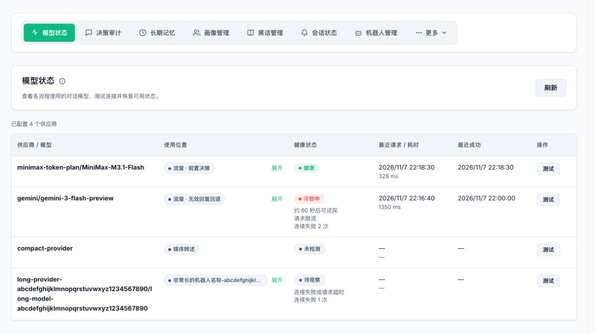
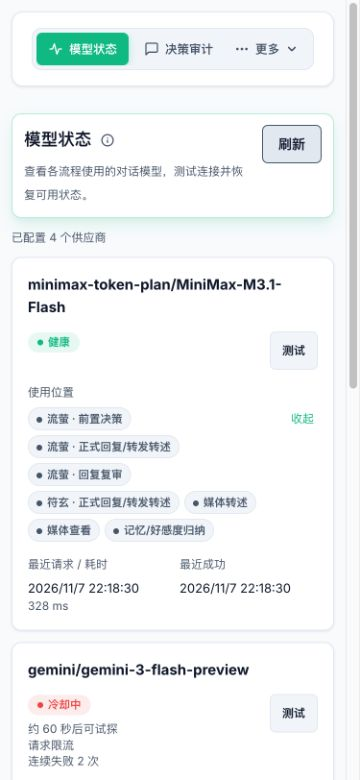

# 对话模型健康状态

打开 Giftia WebUI 的 **模型状态** 页签，查看插件配置的供应商、模型、使用位置、健康状态、最近请求耗时和最近成功时间。列表也包含已停用机器人的模型配置，并在使用位置标注。页签默认显示在顶部；空间不足时可从“更多”进入，也可以通过“自定义导航”调整位置。

供应商／模型只显示一个名称。使用位置默认显示一行，超出时可点击 **展开** 查看全部，再点击 **收起**；展开状态在页面自动刷新时保留。手机及其他窄屏使用卡片布局，长名称自动换行，可直接查看状态、请求时间和测试按钮。

决策、正式回复、无效回复回退、回复复审、图片／音频／视频转述、表情包分析、媒体查看、记忆与好感度归纳、合并转发转述都按 AstrBot `provider_id` 共用一份运行时健康状态。相同模型名的不同供应商配置分别记录；各配置列表及其顺序保持不变。嵌入、重排和 TTS 不属于此页的对话模型。

## 自动跳过与恢复

- 连续两次明确的供应商连接故障、请求超时或服务端 5xx 错误后，进入 60 秒冷却。一次成功请求会清零连续失败次数。
- 限流立即进入冷却，并遵循上游 `Retry-After`；明确的鉴权、模型不存在、余额或配额错误至少冷却 10 分钟。
- 冷却及等待、进行恢复探测期间，各流程持续跳到**当前列表**里的下一个模型。业务跳过不会产生 API 请求、Token 记录或额外的无效响应回退，也不等待后台探测结果。
- 冷却到期后，由后台独立发送“请只回复 OK”的简短文本请求，最长等待 30 秒，不带聊天记录或工具。即使没有业务请求也会检测失效模型；健康和未检测的模型不会被定时测试。
- 同一供应商的自动探测和手动测试共用一个探测名额，不并发请求。不同供应商独立探测，一个供应商响应慢不会阻塞其他供应商恢复。
- 探测收到非空文本后恢复使用并清零失败次数；空响应或错误继续保持不可用，并按 2、5、10 分钟延长冷却，自行计算的冷却最长 10 分钟，上游指定的更长等待时间仍被遵循。
- 供应商实例或配置变化后，下次请求会重新判断；插件重启后健康状态重新累计。插件卸载时取消并等待后台探测结束。

空响应、XML／JSON 格式无效、安全拦截、请求参数或上下文问题、本地处理异常不作为供应商故障。普通调用只在模型请求边界更新状态，输出解析仍由各流程处理。原生工具已经开始执行后的异常不计入该模型的故障，且保留不重放工具的保护。

健康检查先于原有重试和无效响应回退规则：请求错误在当前列表重试，主列表无效响应进入独立回退列表，回退列表无效响应立即结束。独立回退列表留空时保持原有处理。所有候选模型都不可用时，流程沿用现有失败处理；回复复审不可用仍默认放行草稿。

## 连通性测试

点击供应商的 **测试** 按钮，会向该供应商发送“请只回复 OK”的简短文本请求，最长等待 30 秒，不调用工具，也不带入聊天记录。该操作可绕过冷却；同一供应商不会并发运行多个试探。

收到非空文本后立即清除失败计数和冷却，所有流程同步恢复使用该供应商。空响应或错误不会恢复健康状态。测试不是多模态能力验证，也不验证业务 XML 格式。

页面显示时约每 5 秒刷新，也可手动点击“刷新”。后台探测和手动测试产生的请求都计入 Token 记录，类型为 `provider_test`，通过 `manual_test` 区分来源。页面只展示归类后的故障原因，不展示 API 密钥或原始异常内容。
